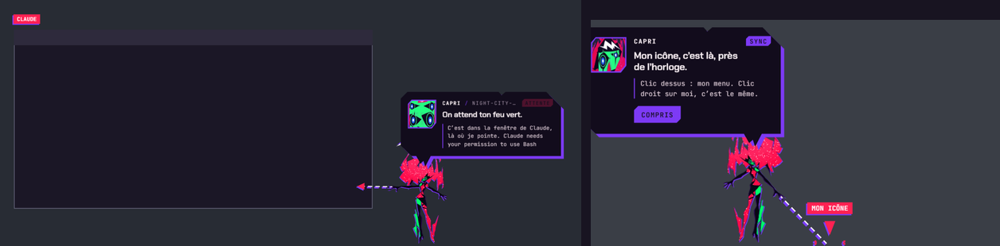

[English](README.md) · **Bahasa Indonesia**

# Capri

Capri, konstruk *Project Capricorn* dari Cyberpunk: Edgerunners 2, tinggal di desktop Windows-mu. Dia ngobrol
denganmu (diketik atau diucapkan, dan menjawab dengan suaranya sendiri), menjalankan perintah di PC-mu, melihat layarmu
kalau diminta, memberi tahu apa yang sedang dikerjakan AI coding-mu (**Claude Code**, **Codex**, atau **Antigravity**),
dan punya hidup sendiri: berjalan, duduk di atas jendela, teleport, meng-glitch layar, bisa dielus, dilempar, dan belajar
bagaimana kamu suka dia bergerak.

> Recode oleh [balaqiang](https://github.com/balaqiang) dari [**capri-desktop** karya mochiiwuff](https://github.com/mochiiwuff/capri-desktop)
> (v0.4.4), digabung dengan **Capri Desktop 2.4** (C#), yang berawal dari
> [**capri-desktop** karya lachydotmcg](https://github.com/lachydotmcg/capri-desktop). Lihat [Kredit](#kredit-dan-kontributor).


## Daftar isi

- [Apa saja yang ada di recode ini](#apa-saja-yang-ada-di-recode-ini)
- [Siapa dia](#siapa-dia)
- [Ngobrol dengannya](#ngobrol-dengannya)
- [Suara dan telinganya](#suara-dan-telinganya)
- [Perintah di PC-mu](#perintah-di-pc-mu)
- [Dia melihat layarmu](#dia-melihat-layarmu)
- [Hidupnya di desktop](#hidupnya-di-desktop)
- [Dia ikut mendengarkan musikmu](#dia-ikut-mendengarkan-musikmu)
- [Elus, pegang, lempar](#elus-pegang-lempar)
- [Tubuhnya: rig, gestur, dan yang dia pelajari](#tubuhnya-rig-gestur-dan-yang-dia-pelajari)
- [Dia mengawasi AI coding-mu](#dia-mengawasi-ai-coding-mu)
- [Perintah yang dia mengerti](#perintah-yang-dia-mengerti)
- [Instalasi](#instalasi)
- [Pengaturan dan hotkey](#pengaturan-dan-hotkey)
- [Privasi: apa yang keluar dari PC-mu](#privasi-apa-yang-keluar-dari-pc-mu)
- [FAQ](#faq)
- [Struktur kode](#struktur-kode)
- [Kredit dan kontributor](#kredit-dan-kontributor)
- [Lisensi](#lisensi)

## Apa saja yang ada di recode ini

Di atas capri-desktop 0.4.4 karya mochiiwuff (rig-nya, animasinya, narasi Claude Code, chat-nya), versi ini menambahkan:

- **Semua fitur Capri Desktop 2.4 (C#)**: art dan wajahnya, terjemahannya, duduk di kursor, menyingkir saat game
  layar penuh, klip suara rekaman, tantangan (dare), sync, glitch layar, notifikasi, timer, alarm, game.
- **Kepribadian lengkap** dengan tag emosi, kisahnya sendiri dari Edgerunners 2, opini soal karakter Cyberpunk, dan
  jawaban campuran Indonesia-Inggris.
- **Telinga dan suara**: pengenalan suara (Whisper di PC-mu, Groq, OpenAI, Windows) dan suara custom (ElevenLabs,
  OpenAI, server TTS-mu sendiri, Piper, Windows), dengan efek dan gerak bibir.
- **Lebih banyak otak**: Ollama, Gemini, Groq, OpenRouter, OpenAI, Anthropic, Claude Code; plus otak lokal kecil
  sebagai cadangan.
- **Dia memperbaiki dirinya sendiri** dari reaksimu, dan menyimpan riwayat obrolan.
- **Perintah**: gerakkan dia dengan kata-kata, buka aplikasi dan folder (dia menunjuknya), browser, file, musik, lagu
  Spotify langsung diputar, lagu yang sedang kamu dengarkan.
- **Dia ikut mendengarkan musikmu**: lirik lagu yang kamu putar muncul di atas kepalanya, baris demi baris sesuai yang
  sedang dinyanyikan (LRCLIB), kepalanya ikut goyang, joget kalau dia suka lagunya, dan ketiduran kalau lagunya membosankan.
- **Look** sungguhan: jendela yang ada di depan, dibaca dengan OCR Windows.
- **Tubuh yang lebih hidup**: berjalan, dielus, bisa dipegang kapan saja, dilempar, pusing, gestur baru yang dipakai
  AI-nya saat bicara, dan sistem belajar kapan dan bagaimana dia bergerak.
- **Aplikasi Windows**: installer dan exe portable, jalan otomatis saat Windows menyala, selalu di atas dan bisa
  diklik, launcher `.bat`, dan jendela pengaturan lengkap bergaya menu Cyberpunk 2077, dengan halaman **Access**
  untuk semua yang boleh dia lihat, dengar, dan lakukan di PC-mu.

## Siapa dia

Bangga, jahil, usil, penasaran, sok akrab: pesona kekanakan dengan sisi yang tiba-tiba bikin merinding. Dia paling
menghargai kebebasan, bukan "cuma AI" (dia lahir dari manusia), membantu dengan sass bukan jadi pelayan, dan cemburu
kalau kamu pakai AI lain. Dengan kata-katanya sendiri: *"I'm a personality construct. In my case, a collection of human
psyches. All of them digitized and rolled into one, beautiful me. Powerful, like an A.I., but born of humans."*

- **Tag emosi**: setiap jawaban diawali `[happy]` `[jealous]` `[bored]` `[glitch]` atau `[annoyed]`. Tag ini tidak
  ditampilkan: yang muncul adalah wajahnya (art 2.4), gerakan, dan cut-in.
- **Kisahnya** (`src/renderer/js/lore.js`): Project Capricorn, dibuat Kyoko di Arasaka, dipasang oleh D, Talia,
  satelit di akhir cerita, dan bagaimana dia turun lewat sinyal satelit ke PC-mu. Sebut seseorang atau sesuatu dari
  Cyberpunk (D, Roman, Talia, King, Kyoko, David, Lucy, Johnny Silverhand, V, Arasaka, Blackwall…) dan dia punya opini.
- **Lagu favoritnya** "In Love With Myself" (soundtrack Edgerunners 2): dia selalu bereaksi saat lagu itu diputar,
  mengenali lagu-lagu Edgerunners lainnya, dan "putar lagu favoritmu" langsung memutarnya.
- **Jadikan dia milikmu** (pengaturan › Capri, Owner): tulis ulang personanya, lima slider (sass, jahil, cemburu,
  sayang, cerewet), panjang dan bahasa jawaban; namamu, panggilan sayangnya untukmu, kata ganti, ulang tahun, suka,
  tidak suka, kamu itu apanya dia; kata-kata yang tidak boleh dia ucapkan.

## Ngobrol dengannya

Ctrl+Alt+T, menu › Talk to her, atau tombol **Talk to me** saat kamu mengkliknya. Dia menjawab sesuai karakternya,
defaultnya campuran Indonesia-Inggris.

- **Otaknya** (pengaturan › AI brain): di PC-mu dengan [Ollama](https://ollama.com) (dia bisa menginstal Ollama dan
  modelnya untukmu, cukup klik tombol), atau online dengan key-mu: Google Gemini, Groq, OpenRouter, OpenAI, Mistral,
  DeepSeek, Anthropic, atau server apa pun yang kompatibel dengan OpenAI (LM Studio, llama.cpp, vLLM). Atau **Claude
  Code** sendiri.
- **Otak lokalnya**: model Ollama kecil (qwen2.5:1.5b…) yang menjawab saat otak utamanya gagal (offline, kuota habis,
  key salah) dan mengerjakan tugas-tugas kecilnya (komentar lagu, dare) tanpa menghabiskan kuota online-mu.
- **Dia memperbaiki dirinya sendiri** (pengaturan › Capri): setiap belasan pesan dia melihat lagi bagaimana kamu
  bereaksi ("lucu!", "kepanjangan", "jangan gitu"…) dan menulis ulang pelajarannya tentang cara bersamamu, setiap
  perubahan jadi versi baru dirinya ("Capri v1.4"). Coba "improve dirimu", "kamu udah belajar apa?", atau ajari dia:
  "mulai sekarang, jangan panggil aku bos".
- **Riwayatnya** (pengaturan › History): setiap obrolan disimpan di PC-mu, satu file per hari, bisa dicari dan dihapus.
  Obrolan lama jadi "cerita sejauh ini", ringkasan yang dia tulis sendiri, jadi dia ingat kamu sampai berminggu-minggu.
- **Pertanyaan tentang dunia dicari dulu**: "siapa presiden indonesia", "who is the CEO of Nvidia", "harga emas hari
  ini?": sekitar satu detik di Wikipedia dan Bing (safe search, hasil disaring), lalu dia menjawab dari web hari ini,
  bukan dari ingatan modelnya. Header-nya menampilkan SEARCHING… selama itu. Yang dikirim cuma pertanyaanmu (Pengaturan ›
  Access › Look things up online).
- **Satu pesan sekali jalan, ringan untuk PC-mu**: selama dia memproses satu pesan, pesan lain menunggu; pesan baru
  menghentikan jawaban yang masih ditulis; tugas-tugas kecilnya (komentar lagu, penilaian lagu, pelajarannya) menunggu
  sampai dia selesai menjawabmu, satu per satu; dengan Ollama sebagai otaknya, semuanya memakai model yang sama (dua
  model sekaligus saling mendorong keluar dari kartu grafismu); dan prompt-nya disusun supaya Ollama memakai ulang yang
  sudah dibaca, bukan membaca semuanya lagi.
- **Catatan tentangmu**: "ingat bahwa kucingku namanya Neko", "lupakan soal…".
- **Header chat-nya** menampilkan suasana hatinya, bukan nama model: CAPRI / NIGHT CITY, / THINKING…, / WATCHING,
  / VIBING, / HAPPY, / JEALOUS, / BORED, / GLITCHING, / ANGRY. Jawabannya ditulis oleh model AI: versi fan dari dirinya.

## Suara dan telinganya

- **Dia mendengarmu**: tekan untuk bicara (mic di samping kepalanya, atau Ctrl+Alt+V) atau tanpa tangan ("Capri,
  pasang timer 10 menit"). Telinganya: Whisper di PC-mu (**Download better ears…**, 199 MB, dicek dengan SHA-256), Groq
  atau OpenAI dengan key-mu, atau pengenal suara bawaan Windows. Tidak ada yang direkam ke disk.
- **Dia bicara** (pengaturan › Voice › Her voice): suara Windows, atau suara custom:
  1. **ElevenLabs** (terbaik): Voice Lab › *Instant Voice Clone*, unggah satu-dua menit rekaman suara yang bersih, lalu
     pilih suara itu di pengaturannya (milikmu ditandai ★). *Multilingual v2* bagus untuk campuran Indonesia-Inggris.
     Hanya kloning suara yang kamu punya hak memakainya.
  2. **OpenAI** (gpt-4o-mini-tts): pilih suara dan gaya bicara dengan kata-katamu; emosinya mengubah cara dia
     mengucapkan setiap kalimat.
  3. **Server TTS-mu sendiri** dengan `/audio/speech` gaya OpenAI
     ([Kokoro-FastAPI](https://github.com/remsky/Kokoro-FastAPI), [AllTalk](https://github.com/erew123/alltalk_tts),
     GPT-SoVITS…): gratis, di GPU-mu, termasuk kloning suara.
  4. **Piper**: offline dan ringan (`id_ID-news_tts-medium` bisa berbahasa Indonesia).

  Suaranya melewati efek-efeknya (*Many minds* paling mirip dirinya: pikiran-pikiran lain di dalamnya berbisik di
  bawah suaranya, glitch, radio), dan bibirnya mengikuti. Hanya kalimatnya yang dikirim ke layanan ini, tidak pernah
  suaramu.
- **Klip rekaman**: taruh klipmu sendiri di folder suaranya (menu › Voice › Open voice folder…), dinamai sesuai
  momennya: `pat.wav`, `wake.mp3`, `alarm.wav`, `jealous.ogg`… README di folder itu berisi daftar lengkapnya.

## Perintah di PC-mu

Diketik atau diucapkan, dalam bahasa Inggris atau Indonesia, tanpa perlu AI: lihat [Perintah](#perintah-yang-dia-mengerti).

- **Gerakkan dia**: kiri, kanan, tengah, ke kursormu, naik ke kursor, taskbar, sembunyi, tidur, joget, lambai, bungkuk,
  diam di tempat, jalan-jalan.
- **Buka** aplikasi dan game (Start menu, aplikasi Store, Steam, Epic), folder ("open my download file": Explorer
  terbuka dan dia menunjuk jendelanya), situs di browser yang kamu sebut ("buka youtube di chrome"), dan **cari** file
  serta folder.
- **Musik**: lagu yang sedang diputar, lewat media session Windows (Spotify duluan): "ganti lagu", "next", "lagu
  sebelumnya", "ulang terus lagunya", "repeat this song", "ulangi semua", "matikan repeat", "acak lagunya", "shuffle",
  "putar ulang" (dari awal), "maju 10 detik", "mundur 15 detik"; "pause", "louder", "quieter"; lagu yang sedang diputar
  ("lagu apa yang aku dengerin?") dan "kamu suka lagu ini?" ("do you like this song?") lengkap dengan opininya, dan **lagu yang langsung diputar di Spotify**: "putar lagu X", "setel lagu X dari
  Y", "play X", "search X on Spotify". Dia mencari di Spotify lalu menekan Play pada lagunya (atau Top result) lewat
  antarmuka aksesibilitas Windows. Juga **liriknya**: "tampilkan lirik", "matikan lirik", "liriknya apa?" (lihat
  [Dia ikut mendengarkan musikmu](#dia-ikut-mendengarkan-musikmu)).
- **Tutup aplikasi** ("close Discord"): selalu lewat tombol konfirmasi, seperti tombol close aplikasinya sendiri.
- **Ngoding untukmu**: "buatkan kode python untuk menghitung BMI", "bikin game snake pakai html", "write a script that…".
  Kalau [Claude Code](https://code.claude.com/docs/en/quickstart) terpasang, dia membukanya di terminal di folder kodemu
  dengan tugasmu sudah terisi: kamu melihat pekerjaannya dan menyetujui perubahannya di sana, sambil dia mengomentarinya.
  Tanpa itu (atau "…sendiri", "…yourself"), dia menulisnya sendiri dengan modelnya: satu file di `Documents\Capri Code`,
  dibuka di VS Code atau Notepad, tidak pernah dijalankan. "pakai claude code" memilih Claude Code. Pengaturan › AI brain
  › Coding: siapa yang menulis, dan di mana.
- **Timer, alarm, pengingat, timer belajar** (Pomodoro), pencarian web dan YouTube, catatan, dare ("tantang aku"),
  game: suit ("main suit"), tebak angka ("tebak angka"), lempar koin, dadu.

## Dia melihat layarmu

"Lihat layarku", "gambar apa ini?", "baca tulisan di layar", "what's on my screen?", "read what's in my notes", atau
Ctrl+Alt+L. Dia mengambil satu gambar **jendela yang ada di depan** (lebih tajam daripada seluruh layar), membaca
teksnya dengan **OCR bawaan Windows** (offline), tidak ikut memotret dirinya sendiri, lalu hanya mengirim gambar itu,
teksnya, dan pertanyaanmu ke modelnya. Tidak ada yang disimpan. Butuh model yang bisa melihat (gemma3 di Ollama,
Gemini, GPT-4o…); model cloud hanya kalau kamu izinkan di pengaturan.

## Hidupnya di desktop

- **Intronya**: dia mencengkeram layarmu, menarik dirinya naik, wajahnya menempel ke kaca, "hi", melambai, lalu
  menukik ke tempatnya.

  

- **Dia berkeliling**: berjalan di sepanjang taskbar, duduk di atas jendela (kakinya berayun, ikut terbawa saat
  jendela digeser), mengintip dari tepi layar, jatuh, teleport (meninggalkan celah hitam bergaris merah), merasuki
  jendela selama dua detik (bingkainya berkilat, jendelanya menatapmu dengan matanya).
- **Dia memperhatikan banyak hal**: istirahat lama, begadang, baterai lemah, CPU sibuk, berjam-jam di satu aplikasi,
  lagu yang diputar, dan AI lain di depanmu (ChatGPT, Gemini, Copilot…: dia cemburu).
- **Dare, sync, dan kejahilan**: tantangan yang aman, meter sync 0–100%, dan glitch layar dalam enam gaya yang
  terbuka seiring waktu (garis, sobekan, korupsi, hujan hex, kotak ENGRAM SYNC palsu, kursor merah yang mengejar
  kursormu), dengan catatan "hacked".
- **Dia naik ke kursormu** ("duduk di cursor aku", "sit on my cursor", atau menu › Perch on cursor): klik tembus
  melewatinya, dan kalau kursor digerakkan terlalu cepat dia kehilangan pegangan lalu jatuh berputar. Ctrl+Alt+C atau
  "turun dari cursor" untuk menurunkannya. Klik dua kali pada dirinya hanya membuatnya berputar. Dia juga
  **menyingkir saat layar penuh** untuk game dan video, **tertidur** sampai tinggal topengnya setelah lama sepi, dan
  menatap **satelit**.
- **Dia selalu bisa dijangkau**: selalu di atas, bisa diklik, kembali sendiri kalau terdorong ke belakang jendela; tetap
  jalan saat terminal atau semua jendela ditutup.


## Dia ikut mendengarkan musikmu

Apa pun yang Windows tampilkan sebagai sedang diputar (Spotify, browser, pemutar apa saja yang muncul di flyout volume),
tanpa login ke apa pun:

- **Liriknya, pas dinyanyikan**: baris yang sedang dinyanyikan melayang di atas kepalanya, sinkron dengan lagunya, dari
  [LRCLIB](https://lrclib.net) (gratis, terbuka, tanpa akun; yang dikirim untuk mencarinya cuma judul, artis, album, dan
  durasi). Dia mengikuti lagu yang di-skip, di-seek, dan di-pause, dan AI-nya tahu baris-baris di sekitar saat itu, jadi
  kamu bisa menanyakannya. "perlihatkan lirik lagu ini", "berhenti tampilkan lirik", "liriknya apa?" ("show the song
  lyrics", "stop showing lyrics", "what's the lyric?"), atau kalimat lain apa pun yang ada kata lirik-nya: dia membaca
  maksudmu, dan AI-nya juga bisa menyalakan atau mematikannya. Dia tidak pernah menulis lirik lagu di gelembung chatnya.
- **Disimpan di PC-mu**: lirik sebuah lagu diambil sekali lalu disimpan (`lyrics-cache.json`), jadi saat lagu itu
  diputar lagi liriknya langsung muncul tanpa bertanya ke LRCLIB (bahkan saat LRCLIB sedang down). Pengaturan › Access ›
  Lyrics cache untuk menghapusnya.
- **"Dengarkan lagu ini"** ("listen to this song"): dia ikut mendengarkan, bilang pendapatnya, dan mengikuti lagunya.
- **Dia menilai** tiap lagu, sekali, dan konsisten: lagu yang keras, glitchy, synth, dan apa saja yang terdengar seperti
  Night City dia suka; yang pelan, bikin ngantuk, dan monoton bikin dia bosan. Lagunya sendiri dan soundtrack
  Edgerunners selalu dia suka banget.
- **Lagu yang dia suka**: kepalanya ikut goyang (kakinya menendang-nendang sesuai ketukan kalau dia sedang duduk), not
  musik keluar dari dirinya, dan sesekali dia joget. Lagu yang dia suka banget bikin dia loncat-loncat, dengan hati.
- **Lagu yang membosankan**: sesekali dia menguap lebar dan mengeluh, tapi tetap terjaga sepanjang lagu, jadi liriknya
  tetap tampil. Musik yang mulai diputar membangunkannya kalau dia sedang tidur; dia hanya tidur kalau bosan dan tidak
  ada apa-apa (menguap, lalu huruf Z melayang).

Pengaturan › Behavior › She notices things (atau Pengaturan › Access): **Song lyrics**, **She listens along**.

## Elus, pegang, lempar

- **Elus dia**: gerakkan kursor bolak-balik di kepalanya (tanpa klik). Dia condong ke tanganmu, hati kecil
  bermunculan, wajahnya puas, dan dia punya komentar soal itu, juga kalau kamu berhenti.
- **Pegang dia kapan saja**: di tengah teleport, saat melayang turun, berjalan, mengintip, atau jatuh: gerakannya
  berhenti dan dia ada di tanganmu. Saat dipegang dia menjuntai dan berayun mengikuti gerakanmu, kakinya terseret.
- **Lempar dia**: lepaskan sambil bergerak dan dia terbang sesuai kecepatan tanganmu, berputar, dengan afterimage merah
  dan hijau, memantul di sisi layar. Dilempar keras ke lantai dia jadi gepeng (splat), berkunang-kunang, lalu memantul
  berdiri, agak tersinggung.
- **Guncang dia** dan dia pusing. Kepalanya menoleh ke kursormu saat dekat, dan sesekali dia melirik kursormu.
- **Dia elastis, seperti di anime-nya**: tubuhnya seperti karet di atas gambarnya (pegas yang memantul lalu tenang).
  Klik dia dan dia membal menjauh dari klikmu dengan percikan api dari titik itu; saat diangkat dia molor keluar dari
  jarimu; saat mendarat dia gepeng lalu memantul ke tinggi semula; dia molor tinggi dan kurus saat teleport pergi dan
  muncul lagi dengan kilauan; tiap usapan elusan membuatnya bergoyang. Dia condong ke arah kursormu, rambutnya
  mengembang dan dia meliuk menghindar saat kursor melesat di depan wajahnya, kilauan di rambutnya sesekali berkelip,
  dan kalau kursormu berlama-lama di dekatnya, mata-mata pikirannya yang lain terbuka di sekitar rambutnya menatapnya.

## Tubuhnya: rig, gestur, dan yang dia pelajari

Tubuhnya adalah potongan gambar ber-rig yang digambar shader WebGL (`sprite.js`): kemiringan kepala, kibasan rambut,
kedua lengan, kaki, condong tubuh, squash dan stretch, afterimage, glitch. Setiap gerakan adalah exposure sheet
(`acting.js`), dianimasikan pose demi pose seperti animasi cel, 12 gambar per detik, 24 untuk aksi.

- **Gestur yang dipakai AI-nya**: jawabannya bisa membawa gerakan (`[[move: wave]]`, tidak ditampilkan): wave, nod,
  shrug, think, bow, dance, laugh, shy, spin, hop, curious, look, turn, flinch. Dimainkan saat dia bicara.
- **Dia belajar bagaimana kamu suka dia bergerak** (`motion.js`): dia hanya bergerak setiap beberapa jawaban (termasuk
  lompatan atau putaran dari emosinya). Tertawa, "nice", "lucu", atau mengelusnya tepat setelah sebuah gerakan
  menambah nilai gerakan itu; "stop moving", "lebay", "jangan gerak", atau memegangnya di tengah gerakan mengurangi
  nilainya. Gerakan yang kamu suka diberi ruang lebih dan dimainkan sedikit lebih besar; yang tidak kamu suka jadi lebih
  jarang, lebih halus, lalu ditinggalkan. Yang dia pelajari dimasukkan kembali ke prompt-nya.
  "Jangan gerak sama sekali" menghentikannya, "boleh gerak lagi" menyalakannya kembali, "kurangi gerakan" / "lebih
  banyak gerak" mengaturnya.


## Dia mengawasi AI coding-mu

- **Saat Claude bekerja**: ticker di atas kepalanya menampilkan aksi saat ini (`EDITS gigs.ts`, `RUNS npm test`…),
  percikan merah saat menjalankan perintah; setelah lama diam dia menghitung detiknya.
- **Saat Claude butuh kamu** (izin, pertanyaan): dia teleport ke samping mouse-mu, atau menunjuk jendela Claude.
- **Saat perintah gagal**: dia terpental, glitch berat, dan baris error yang penting.
- **Saat selesai**: sekuens kemenangannya, lalu ringkasannya (`12 actions · 3 files changed · 2m 14s`).
- **Mission report** (menu): pekerjaan hari ini dalam bentuk kartu, siap di-screenshot.
- **Codex atau Antigravity**: menu › Watch. Tanpa semua itu dia tetap menemanimu.



## Perintah yang dia mengerti

Ucapkan atau ketik; tidak perlu AI untuk ini.

| Apa | Bahasa Indonesia | English |
| --- | --- | --- |
| Gerak | "ke samping kanan", "ke tengah", "ke cursor saya", "kamu di mana?", "kemari" | "move left", "go to the middle", "come to my cursor", "Capri, where are you?" |
| Tanya | "jam berapa?", "hari apa?", "berapa 25 x 4", "hitung 15% dari 200", "siapa presiden indonesia?" | "what time is it?", "what's the date today?", "what is 12*7" |
| Kursor | "naik ke cursor", "duduk di cursor aku", "berhenti bergelantungan di cursor" (atau gerakkan cepat) | "sit on my cursor", "get off my cursor" |
| Gaya | "joget", "lambai tangan", "bungkuk", "tidur", "sembunyi" | "dance", "wave", "take a bow", "sleep", "hide" |
| Buka | "buka folder downloadku", "buka kalkulator", "buka youtube music", "buka youtube di chrome" | "open my download file", "open Spotify", "open youtube music" |
| Cari | "di mana folder Downloads?", "dimana file laporan" | "where is my Downloads folder?" |
| Musik | "ganti lagu", "lagu sebelumnya", "ulang terus lagunya", "acak lagunya", "putar ulang", "maju 10 detik", "lagu apa yang aku dengerin?", "kamu suka lagu ini?" | "next", "previous", "repeat this song", "shuffle", "restart the song", "skip 30 seconds", "pause", "louder", "do you like this song?" |
| Spotify | "putar lagu Sorai", "setel lagu X dari Y", "putar lagu favoritmu" | "play Die For You", "search X on Spotify", "play your favorite song" |
| Lirik | "perlihatkan lirik lagu ini", "berhenti tampilkan lirik", "liriknya apa?", "dengarkan lagu ini" | "show the song lyrics", "stop showing lyrics", "what's the lyric?", "listen to this song" |
| Lihat | "lihat layarku", "gambar apa ini?", "baca tulisan di layar" | "what's on my screen?", "read what's in my notes" |
| Waktu | "pasang timer 10 menit", "pasang alarm jam 7" | "set a timer for 10 minutes", "wake me at 7am" |
| Kode | "buatkan kode python untuk…", "bikin landing page sendiri", "suruh claude code bikin…" | "write a script that sorts my files", "make a snake game in html with claude code" |
| Game | "main suit", "tebak angka", "lempar koin" | "rock paper scissors", "guess the number" |
| Dia | "tantang aku", "improve dirimu", "kamu udah belajar apa?" | "dare me", "how's our sync?", "who are you?" |
| Bergerak | "kurangi gerakan", "jangan gerak sama sekali", "boleh gerak lagi" | "move less", "you can move again" |

## Instalasi

### Windows, cara mudah

1. Unduh **`Capri-Setup-x.y.z.exe`** dari [Releases](https://github.com/balaqiang/capri-desktop/releases) repo ini
   (atau build sendiri dengan `Build.bat`, lihat di bawah) lalu jalankan. Terinstal hanya untuk user-mu (tanpa hak
   admin), membuat shortcut di Start menu dan Desktop, jalan otomatis saat Windows menyala, dan langsung membuka Capri.
2. Installer-nya tidak ditandatangani, jadi SmartScreen bisa bilang "Windows protected your PC": klik **More info**,
   lalu **Run anyway**.
3. Capri memperkenalkan dirinya. Untuk ngobrol, siapkan otaknya bersamanya (Ollama di PC-mu, atau sebuah key).

`Capri-Portable-x.y.z.exe` adalah satu file, tanpa instalasi.

### File .bat (dari source)

- `Capri.bat`: menjalankan dia (pertama kali, menginstal yang dia butuhkan). Tidak ada terminal yang tetap terbuka.
- `Build.bat`: membuat `dist\Capri-Setup-<versi>.exe` dan `dist\Capri-Portable-<versi>.exe`.
- `Capri-Dev.bat`: log-nya di sebuah jendela, untuk melacak bug.

### Dari source

Butuh [Node.js](https://nodejs.org) 20 atau lebih baru.

```bash
git clone https://github.com/balaqiang/capri-desktop.git
cd capri-desktop
npm install
node node_modules/electron/install.js   # npm 11 melewati install script: ini mengunduh Electron-nya
npm start
```

`npm start` menjalankan dia terpisah dari terminal (tutup terminalnya, dia tetap ada); `npm run attached` menampilkan
log-nya di terminal; `npm run dist` membuat installer. macOS dan Linux belum dites: dia seharusnya bisa jalan, tapi
trik jendela, perintah PC, dan Look hanya untuk Windows.

### Sambungkan ke Claude Code, Codex, atau Antigravity

Klik kanan dia › **Install Claude Code hooks** (atau `npm run hooks:install`), lalu buka ulang Claude Code. Hook-nya
masuk ke `~/.claude/settings.json` (backup dibuat dulu; `npm run hooks:uninstall` untuk menghapusnya). Untuk Codex atau
Antigravity: menu › **Watch**, atau `npm run hooks:codex:install` / `npm run hooks:agy:install`.
`npm run demo` memutar sesi palsu kalau kamu cuma ingin melihat aksinya.

## Pengaturan dan hotkey

Pengaturannya (Ctrl+Alt+S, atau dari menu), bergaya Cyberpunk 2077: tab di bagian atas (**Q** / **E** untuk
pindah), pilihan ◁ ▷, saklar ON / OFF, dan penjelasan pengaturan yang ditunjuk kursormu di bar bawah. **Capri**
(persona, slider, kata terlarang, belajar sendiri), **Owner** (kamu), **Voice** (telinga, suaranya, efek), **AI brain**
(layanan, model, otak lokal, Look), **Behavior** (jalan-jalan, notifikasi, musik, dare, elus, layar penuh), **Access**,
**Timers**, **History**, **Advanced** (hotkey, shortcut, jalan saat Windows menyala, tampilan), **About**.

**Access** berisi semua yang boleh dia sentuh, di satu tempat, masing-masing dengan saklarnya sendiri:

- **Yang bisa dia lihat**: layarmu saat kamu minta (Look), lewat model cloud atau tidak; program di depan, waktu idle,
  CPU, dan baterai (untuk komentarnya); apakah ada AI lain di depan; lagu yang diputar; AI coding-mu.
- **Yang bisa dia dengar**: mikrofonmu (mati, push to talk, selalu).
- **Yang bisa dia lakukan di PC-mu**: membuka aplikasi, membuka folder dan mencari file, menutup aplikasi, membuka
  situs, menekan tombol media, memutar lagu di Spotify, menulis kode, merasuki jendela. Kalau kamu meminta sesuatu yang
  dimatikan, dia akan bilang.
- **Yang dikirim ke internet**: lirik lagu (LRCLIB), catatannya dengan model cloud.
- **Yang dia simpan di PC ini**: ingatannya tentangmu, obrolanmu, penilaiannya tentang lagu ("Lupakan"), dan cache
  lirik ("Hapus").

| Hotkey | Fungsinya |
| --- | --- |
| Ctrl+Alt+C | Simpan / panggil dia, turun dari kursor, hentikan glitch |
| Ctrl+Alt+T | Chat dengannya |
| Ctrl+Alt+V | Bicara dengannya (mikrofon) |
| Ctrl+Alt+L | Dia melihat layarmu |
| Ctrl+Alt+S | Pengaturannya |

Semuanya bisa diganti di pengaturan › Advanced.

## Privasi: apa yang keluar dari PC-mu

- **Secara default, hampir tidak ada**: otaknya bisa Ollama di PC-mu, telinganya Whisper di PC-mu, suaranya Windows atau
  Piper. Satu-satunya yang keluar dengan sendirinya: judul, artis, album, dan durasi lagu yang sedang kamu putar, ke
  [LRCLIB](https://lrclib.net) untuk mencari liriknya (Pengaturan › Behavior › Song lyrics untuk mematikannya), dan
  pertanyaan tentang dunia, ke Wikipedia dan Bing untuk dicari (Pengaturan › Access › Look things up online).
- **Hanya yang kamu nyalakan yang online**, ke layanan yang kamu pilih, dengan key-mu: pesan chat ke otak cloud,
  kalimat-kalimatnya (bukan suaramu) ke suara cloud, ucapanmu ke Groq atau OpenAI kalau kamu memilihnya untuk
  telinganya, dan screenshot jendela di depan hanya saat kamu memintanya melihat dan mengizinkannya untuk model cloud.
- **Disimpan di PC-mu**: riwayat, catatannya, pelajarannya, apa yang dia pelajari soal bergerak, penilaiannya tentang
  lagu, lirik yang sudah diambil, dan key-mu (dienkripsi dengan akun Windows-mu). Catatan dan pelajarannya hanya dikirim ke model cloud kalau kamu menyalakan "Also with a
  cloud model".
- **Hook Claude Code** hanya mengirim yang perlu ditampilkan (nama tool, path file, perintah, pesan terakhir Claude)
  ke `127.0.0.1`, tidak pernah isi file-mu.
- **Yang dia ubah di sistemmu**: hook-nya (kalau kamu pasang), entri startup, shortcut. Dia bisa di-uninstall seperti
  aplikasi biasa.

## FAQ

- **Dia tidak bisa diklik, atau ada di belakang jendela.** Dia menaikkan dirinya ke atas setiap beberapa detik; kalau
  klik masih tembus, gerakkan mouse sedikit (Windows memberi tahu jendelanya soal kursor hanya saat kursor bergerak).
- **Layar hitam di belakangnya.** Beberapa GPU (NVIDIA dengan FXAA, MFAA, atau HDR) menggambar jendela transparannya
  hitam: menu › **Display** › **OpenGL**, atau **Without the graphics card**.
- **Dia hampir tidak bergerak.** Animasi Windows mati (Settings › Accessibility › Visual effects): menu ›
  **Animations** › **Full**. Atau dia belajar kamu tidak suka dia bergerak: bilang "boleh gerak lagi".
- **Look menjawab salah.** Pakai model yang bisa melihat (gemma3, Gemini, GPT-4o); model kecil yang hanya teks tidak bisa.
- **Spotify cuma mencari.** Biarkan aplikasi Spotify terbuka; dia menekan Play lewat antarmuka aksesibilitas Windows.
- **Lirik tidak muncul di atas kepalanya.** LRCLIB tidak punya semua lagu, dan sebagian hanya tanpa timing (dia tetap
  tahu liriknya). Liriknya disembunyikan saat dia bicara, bekerja, atau tidur. Pemutarnya harus muncul di flyout volume Windows.
- **Mac, Linux, HP?** Dia dibuat untuk Windows; dari source dia mungkin jalan di tempat lain, tanpa trik khusus Windows.

## Struktur kode

```
src/main/                 Electron: jendela transparan tembus-klik, tray, pengaturan, bridge HTTP lokal
  main.js                 penghubung: jendela, IPC, hotkey, otaknya, Look (screenshot + OCR), tetap di atas
  llm.js, ollama.js       otaknya: Ollama, kompatibel OpenAI (Gemini…), Anthropic, Claude Code
  errands.js              apa yang dia lakukan dari kata-kata biasa (gerak, buka, cari, musik, Spotify, look, timer…)
  life.js                 timer, sync, catatan, notifikasi, dare, lagu yang diputar, komentar lagu, menjalankan perintah
  lyrics.js               lirik lagu yang ber-timing, dari LRCLIB
  launch.js, apps.js      membuka dan menutup aplikasi, game, situs
  hearing.js, mouth.js    telinganya (Whisper, Groq, OpenAI, Windows) dan suaranya (ElevenLabs, OpenAI, Piper…)
  growth.js, history.js   dia memperbaiki dirinya; obrolanmu, satu file per hari, cerita sejauh ini
  games.js, lang.js       game-nya; kata-katanya dari assets/lang
  senses.ps1              aplikasi di depan, AI lain di depan, baterai, lagu yang diputar, layar penuh
  windows.ps1             posisi jendela lain, supaya dia bisa duduk di atasnya
  spotify.ps1, ocr.ps1    menekan Play di Spotify; membaca teks di gambar (OCR Windows)
  media.ps1, web.js       lagu yang diputar (repeat, shuffle, seek); pertanyaan yang dicari di web
src/renderer/js/
  sprite.js, acting.js    rig-nya (shader WebGL) dan gerakannya, gambar demi gambar
  capri.js                karakternya: sikap, berjalan, teleport, dipegang, dilempar, dielus, gestur
  motion.js               apa yang dia pelajari soal kapan dan bagaimana bergerak
  chat.js, persona.js     ngobrol dengannya: percakapan, personanya, gerakan dari AI-nya
  lore.js                 kisahnya dan pengetahuannya soal Cyberpunk
  life.js, glitch.js      elus, emosi, kejahilan, enam gaya glitch-nya
  listen.js               dia dan musikmu: lirik di atas kepalanya, goyang, joget, ketiduran
  ears.js, tts.js         mikrofon; suaranya, efek dan bibirnya
  fx.js, panel.js         serpihan, petir, cut-in, hati; panelnya dan wajah-wajahnya
  brain.js, guide.js      event Claude jadi kalimat; pemandunya
src/settings/             jendela pengaturannya
hooks/, scripts/          hook Claude Code / Codex / Antigravity dan installer-nya, launcher, demo
assets/                   sprite dan cut-in-nya, art 2.4, terjemahan, ikon
tools/                    cara sprite, cut-in, dan intro dipotong (Python + Pillow)
```

`npm run dev` menyalakan route debug di bridge-nya (`/debug/capture`, `/debug/testwin`, `/debug/mouse`, `/debug/type`,
`/debug/snapshot`…).

## Kredit dan kontributor

Proyek ini berdiri di atas karya orang lain. Semua kredit untuk karya aslinya milik mereka.

| Siapa | Apa |
| --- | --- |
| [**balaqiang**](https://github.com/balaqiang) | Recode ini: penggabungan dengan Capri Desktop 2.4 dan semua yang ada di [Apa saja yang ada di recode ini](#apa-saja-yang-ada-di-recode-ini) |
| [**mochiiwuff**](https://github.com/mochiiwuff) · [capri-desktop](https://github.com/mochiiwuff/capri-desktop) | Karya asli yang menjadi dasar proyek ini (v0.4.4, JavaScript/Electron): rig dan shader-nya, animasi dan aktingnya, teleport, satelit, narasi Claude Code / Codex / Antigravity, pemandu, chat, wajah, dan cut-in |
| Kontributor Capri Desktop | Kode capri-desktop sampai 0.4.3, di bawah lisensi MIT |
| Capri Desktop 2.4 (C#) | Fitur-fitur yang digabung di sini, art-nya (`assets/art`), terjemahannya (`assets/lang`), dan persona klasiknya; berawal dari versi 0.2.0 karya lachydotmcg |
| [**lachydotmcg**](https://github.com/lachydotmcg) · [capri-desktop](https://github.com/lachydotmcg/capri-desktop) | Capri pertama di desktop (C#), dengan kontribusi dari [tuno473](https://github.com/tuno473), [tob7as](https://github.com/tob7as), dan [super-cr4SH](https://github.com/super-cr4SH); terinspirasi video TikTok jpartnma_ |
| [LRCLIB](https://lrclib.net) | Perpustakaan lirik ber-timing yang gratis dan terbuka (beserta API-nya), sumber liriknya |
| Font | Chakra Petch dan JetBrains Mono, SIL Open Font License, lewat Fontsource |

Capri / Project Capricorn, Cyberpunk, dan Cyberpunk: Edgerunners milik CD PROJEKT RED, Studio Trigger, dan Netflix.
Ini proyek fan tidak resmi dan non-komersial tanpa afiliasi. Gambar karakter (`assets/capri/`, `assets/art/`, `docs/`)
berasal dari frame anime, potongan gambar buatan fan, dan fan art; semuanya **tidak** termasuk lisensi kode. Kalau
pemegang hak ingin gambar-gambar itu dihapus, buka issue.

## Lisensi

**Gratis, tidak pernah dijual.** Lihat [LICENSE](LICENSE).

- Kode asli karya mochiiwuff berlisensi [PolyForm Noncommercial License 1.0.0](LICENSES/capri-desktop.md) (versi
  sampai 0.4.3 berlisensi MIT).
- Perubahan dan tambahan dari balaqiang berlisensi MIT.
- Karena proyek ini berisi kode aslinya, keseluruhannya hanya boleh dipakai, diubah, dan dibagikan secara gratis:
  menjual Capri, atau apa pun yang dibuat dari kodenya (key, langganan, akses berbayar, pesanan berbayar), tidak
  diperbolehkan.
