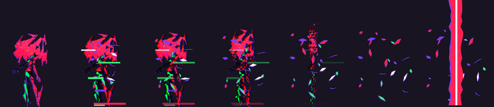
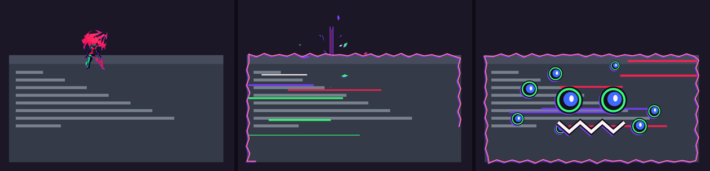
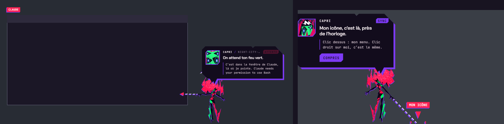

**English** · [Bahasa Indonesia](README.id.md)

# Capri

Capri, the *Project Capricorn* construct from Cyberpunk: Edgerunners 2, lives on your Windows desktop. She talks to you
(typed or spoken, out loud in her own voice), runs errands on your PC, looks at your screen when you ask, tells you what
your coding AI is up to (**Claude Code**, **Codex** or **Antigravity**), and has a life of her own: she walks, sits on
your windows, teleports, glitches your screen, gets petted, thrown around, and learns how you like her to move.

> A recode by [balaqiang](https://github.com/balaqiang) of [**capri-desktop** by mochiiwuff](https://github.com/mochiiwuff/capri-desktop)
> (v0.4.4), merged with **Capri Desktop 2.4** (C#), itself started from
> [**capri-desktop** by lachydotmcg](https://github.com/lachydotmcg/capri-desktop). See [Credits](#credits-and-contributors).




## Contents

- [What's in this recode](#whats-in-this-recode)
- [Who she is](#who-she-is)
- [Talk to her](#talk-to-her)
- [Her voice and her ears](#her-voice-and-her-ears)
- [Errands on your PC](#errands-on-your-pc)
- [She looks at your screen](#she-looks-at-your-screen)
- [Her life on your desktop](#her-life-on-your-desktop)
- [Petting, grabbing, throwing](#petting-grabbing-throwing)
- [Her body: rig, gestures, and what she learns](#her-body-rig-gestures-and-what-she-learns)
- [She watches your coding AI](#she-watches-your-coding-ai)
- [Commands she understands](#commands-she-understands)
- [Install](#install)
- [Settings and hotkeys](#settings-and-hotkeys)
- [Privacy: what leaves your PC](#privacy-what-leaves-your-pc)
- [FAQ](#faq)
- [How it's built](#how-its-built)
- [Credits and contributors](#credits-and-contributors)
- [License](#license)

## What's in this recode

On top of mochiiwuff's capri-desktop 0.4.4 (her rig, her animation, Claude Code narration, her chat), this version adds:

- **Everything from Capri Desktop 2.4 (C#)**: its art and faces, its translations, perching on your cursor, stepping aside
  for fullscreen games, recorded voice clips, dares, sync, screen glitches, notices, timers, alarms, games.
- **A full personality** with emotion tags, her own story from Edgerunners 2, opinions on Cyberpunk characters, and
  Indonesian-English replies.
- **Ears and a voice**: speech recognition (Whisper on your PC, Groq, OpenAI, Windows) and a custom voice (ElevenLabs,
  OpenAI, your own TTS server, Piper, Windows), with effects and lip-sync.
- **More brains**: Ollama, Gemini, Groq, OpenRouter, OpenAI, Anthropic, Claude Code; a small local brain as a backup.
- **She improves herself** from how you react, and keeps a history of your chats.
- **Errands**: move her by words, open apps and folders (she points at them), browsers, files, music, Spotify songs
  played for you, what's playing.
- **Look** for real: the window in front, read with Windows' OCR.
- **A livelier body**: walking, petting, grabbing her any time, throwing, dizziness, new gestures her AI uses while she
  talks, and a learning system for when and how she moves.
- **A Windows app**: installer and portable exe, starts with Windows, stays on top and clickable, `.bat` launchers,
  a full settings window.

## Who she is

Proud, playful, mischievous, curious, invasively familiar: childlike charm with a sudden unsettling edge. She values
freedom above all, is never "just an AI" (born of humans), helps with sass instead of servility, and gets jealous when
you use other AIs. In her words: *"I'm a personality construct. In my case, a collection of human psyches. All of them
digitized and rolled into one, beautiful me. Powerful, like an A.I., but born of humans."*

- **Emotion tags**: every answer starts with `[happy]` `[jealous]` `[bored]` `[glitch]` or `[annoyed]`. It's never
  shown: her face (the 2.4 art), a move and a cut-in follow it instead.
- **Her story** (`src/renderer/js/lore.js`): Project Capricorn, built by Kyoko at Arasaka, slotted by D, Talia, the
  satellite at the end, and how she slipped down a downlink into your PC. Name someone or something from Cyberpunk
  (D, Roman, Talia, King, Kyoko, David, Lucy, Johnny Silverhand, V, Arasaka, the Blackwall…) and she has an opinion.
- **Her favorite song** is "In Love With Myself" (Edgerunners 2 soundtrack): she always reacts when it plays, and knows
  the other Edgerunners songs.
- **Make her yours** (settings › Capri, Owner): rewrite her persona, five dials (sass, mischief, jealousy, affection,
  chattiness), reply length and language; your name, her pet name for you, pronouns, birthday, likes, dislikes, what
  you are to her; words she must never say.

## Talk to her

Ctrl+Alt+T, her menu › Talk to her, or the **Talk to me** button when you click her. She answers in character, in an
Indonesian-English mix by default.

- **Her brain** (settings › AI brain): on your PC with [Ollama](https://ollama.com) (she can install it and a model for
  you, with buttons), or online with your key: Google Gemini, Groq, OpenRouter, OpenAI, Mistral, DeepSeek, Anthropic, or
  any OpenAI-compatible server (LM Studio, llama.cpp, vLLM). Or **Claude Code** itself.
- **Her local brain**: a small Ollama model (qwen2.5:1.5b…) answers when her main brain fails (offline, out of quota, a
  bad key) and does her small jobs (song comments, dares) without spending your online quota.
- **She improves herself** (settings › Capri): every dozen messages she looks back at how you reacted ("lucu!",
  "kepanjangan", "jangan gitu"…) and rewrites her lessons on how to be with you, each change a new version of her
  ("Capri v1.4"). Ask "improve dirimu", "kamu udah belajar apa?", or teach her: "mulai sekarang, jangan panggil aku bos".
- **Her history** (settings › History): every chat turn kept on your PC, a file a day, searchable and deletable. Older
  chats become "the story so far", a summary she writes herself, so she remembers you for weeks.
- **Notes about you**: "remember that my cat is called Neko" / "ingat bahwa…", "forget about…" / "lupakan soal…".
- **It's AI**: her replies are written by a model, a fan version of her; the chat panel says so every time.

## Her voice and her ears

- **She hears you**: push to talk (the mic by her head, or Ctrl+Alt+V) or hands-free ("Capri, set a timer for 10
  minutes"). Her ears: Whisper on your PC (**Download better ears…**, 199 MB, checked by SHA-256), Groq or OpenAI with
  your key, or Windows' own recognizer. Nothing is recorded to disk.
- **She speaks** (settings › Voice › Her voice): Windows voices, or a custom voice:
  1. **ElevenLabs** (best): Voice Lab › *Instant Voice Clone*, upload a minute or two of clean speech, then pick that
     voice in her settings (yours are marked ★). *Multilingual v2* handles the Indonesian-English mix. Only clone a
     voice you have the right to use.
  2. **OpenAI** (gpt-4o-mini-tts): a voice and a style in your words; her emotion changes how she says each line.
  3. **Your own TTS server** with OpenAI's `/audio/speech`
     ([Kokoro-FastAPI](https://github.com/remsky/Kokoro-FastAPI), [AllTalk](https://github.com/erew123/alltalk_tts),
     GPT-SoVITS…): free, on your GPU, voice cloning included.
  4. **Piper**: offline and light (`id_ID-news_tts-medium` speaks Indonesian).

  Her voice goes through her effects (*Many minds* sounds most like her: her other minds whispering under it, glitch
  stutters, radio), and her lips follow it. Only her lines go to these services, never what you say.
- **Recorded clips**: drop your own in her voice folder (her menu › Voice › Open voice folder…), named for their
  moment: `pat.wav`, `wake.mp3`, `alarm.wav`, `jealous.ogg`… A README in the folder lists them all.

## Errands on your PC

Typed or spoken, in English or Indonesian, no AI needed: see [Commands](#commands-she-understands).

- **Move her**: left, right, the middle, to your cursor, ride your cursor, the taskbar, hide, sleep, dance, wave, bow,
  stay put, wander.
- **Open** apps and games (Start menu, Store apps, Steam, Epic), folders ("open my download file": Explorer opens and she
  points at the window), sites in the browser you name ("buka youtube di chrome"), and **find** files and folders.
- **Music**: media keys ("pause", "lagu berikutnya", "louder"), what's playing ("lagu apa yang aku dengerin?") with her
  opinion on it, and **songs played on Spotify**: "play X", "putar lagu X", "setel lagu X dari Y", "search X on Spotify".
  She searches Spotify and presses Play on the song (or the Top result) through Windows' accessibility interface.
- **Close an app** ("close Discord"): only behind a button, the way its own close button does.
- **Timers, alarms, reminders, a study timer** (Pomodoro), web and YouTube searches, notes, dares ("tantang aku"),
  games: rock paper scissors ("main suit"), guess the number ("tebak angka"), a coin, dice.

## She looks at your screen

"What's on my screen?", "can you see what image this?", "read what's in my notes", "gambar apa ini?", "baca tulisan di
layar", or Ctrl+Alt+L. She takes one picture of **the window in front** (sharper than the whole screen), reads its text
with **Windows' own OCR** (offline), leaves herself out of the picture, and shows her model only that picture, its text
and your question. Nothing is kept. It needs a model that can see (gemma3 on Ollama, Gemini, GPT-4o…); a cloud model
only if you allow it in settings.

## Her life on your desktop

- **Her intro**: she grabs your screen, hauls herself up, her face hits the glass, "hi", a wave, and she dives down
  to her spot.

  

- **She gets around**: walks along your taskbar, sits on your windows (legs kicking, riding along when you move
  them), peeks in from the edges, falls, teleports (a black slit with a red line where she was), possesses a window
  for two seconds (its frame crackles, it looks at you with her eyes).
- **She notices things**: a long break, a late night, a low battery, a busy CPU, hours in one app, what's playing,
  and another AI in front of you (ChatGPT, Gemini, Copilot…: she gets jealous).
- **Dares, sync and mischief**: harmless dares, a 0–100% sync meter, and screen glitches in six styles it unlocks
  (bars, tear, corruption, hex rain, the fake ENGRAM SYNC box, a red cursor chasing yours), with "hacked" notes.
- **She rides your cursor** (double-click her), **steps aside for fullscreen** games and videos, **sleeps** down to
  her mask after a quiet while, and looks up at **the satellite**.
- **She stays reachable**: always on top, clickable, back by herself if something pushed her behind your windows; she
  keeps running when you close the terminal or every window.




## Petting, grabbing, throwing

- **Pet her**: stroke her head back and forth with your pointer (no click). She leans into your hand, hearts float
  up, her face goes content, and she has things to say about it, and about you stopping.
- **Grab her any time**: mid-teleport, floating in, walking, peeking, falling: the move stops and she's in your hand.
  Held, she dangles and swings behind your moves, legs trailing.
- **Throw her**: let go while moving and she flies off with your hand's speed, tumbling, red and green afterimages
  behind her, bouncing off the screen's sides. Thrown hard into the floor she goes flat (splat), sees stars and springs
  back up, a little offended.
- **Shake her** and she gets dizzy. Her head turns toward your pointer when it's near, and now and then she side-eyes it.

## Her body: rig, gestures, and what she learns

Her body is a rigged cut-out drawn by a WebGL shader (`sprite.js`): head tilt, mane flare, both arms, legs, lean, squash
and stretch, afterimages, glitch. Every move is an exposure sheet (`acting.js`), animated pose to pose like cel
animation, on twos (12 drawings a second), on ones for the action.

- **Gestures her AI uses**: her answers can carry a move (`[[move: wave]]`, never shown): wave, nod, shrug, think, bow,
  dance, laugh, shy, spin, hop, curious, look, turn, flinch. It plays as she talks.
- **She learns how you like her to move** (`motion.js`): she moves only every few answers (her emotion's hop or turn
  too). Laughing, "nice", "lucu" or petting her right after a move counts for it; "stop moving", "lebay", "jangan gerak"
  or grabbing her mid-move counts against it. Moves you like get more room and are played a little bigger; moves you
  don't get rarer, subtler, then dropped. What she learned goes back into her prompt.
  "Jangan gerak sama sekali" stops it, "boleh gerak lagi" brings it back, "kurangi gerakan" / "lebih banyak gerak" tune it.


## She watches your coding AI

- **While Claude works**: a ticker over her head shows the current action (`EDITS gigs.ts`, `RUNS npm test`…), red
  sparks when it runs a command; after a long silence she counts the seconds.
- **When Claude needs you** (permission, question): she teleports next to your mouse, or points at Claude's window.
- **When a command fails**: knocked back, heavy glitch, the error line that matters.
- **When it's done**: her victory sequence, then the summary (`12 actions · 3 files changed · 2m 14s`).
- **Mission report** (her menu): today's work as a card, ready to screenshot.
- **Codex or Antigravity** instead: her menu › Watch. Without any of them she simply keeps you company.



## Commands she understands

Say or type them; no AI needed for these.

| What | English | Indonesian |
| --- | --- | --- |
| Move | "move left", "go to the middle", "come to my cursor" | "ke samping kanan", "ke tengah", "ke cursor saya" |
| Cursor | "ride my cursor", "get off my cursor" | "naik ke cursor", "berhenti bergelantungan di cursor" |
| Moods | "dance", "wave", "take a bow", "sleep", "hide" | "joget", "lambai tangan", "bungkuk", "tidur", "sembunyi" |
| Open | "open my download file", "open Spotify", "open youtube in chrome" | "buka folder downloadku", "buka kalkulator", "buka youtube di chrome" |
| Find | "where is my Downloads folder?" | "di mana folder Downloads?", "dimana file laporan" |
| Music | "pause", "next", "what am I listening to?" | "lagu berikutnya", "lagu apa yang aku dengerin?" |
| Spotify | "play Die For You", "search X on Spotify" | "putar lagu Sorai", "setel lagu X dari Y" |
| Look | "what's on my screen?", "read what's in my notes" | "lihat layarku", "gambar apa ini?", "baca tulisan di layar" |
| Time | "set a timer for 10 minutes", "wake me at 7am" | "pasang timer 10 menit", "pasang alarm jam 7" |
| Games | "rock paper scissors", "guess the number" | "main suit", "tebak angka", "lempar koin" |
| Her | "dare me", "how's our sync?", "who are you?" | "tantang aku", "improve dirimu", "kamu udah belajar apa?" |
| Moving | "move less", "you can move again" | "kurangi gerakan", "jangan gerak sama sekali", "boleh gerak lagi" |

## Install

### Windows, the easy way

1. Download **`Capri-Setup-x.y.z.exe`** from this repo's [Releases](https://github.com/balaqiang/capri-desktop/releases)
   (or build it yourself with `Build.bat`, below) and run it. It installs for your user only (no admin rights), adds
   Start menu and Desktop shortcuts, starts with Windows, and starts Capri.
2. The installer isn't signed, so SmartScreen may say "Windows protected your PC": **More info**, then **Run anyway**.
3. Capri introduces herself. To talk with her, set up a brain with her (Ollama on your PC, or a key).

`Capri-Portable-x.y.z.exe` is one file, nothing installed.

### The .bat files (from the source)

- `Capri.bat`: starts her (the first time, it installs what she needs). No terminal stays open.
- `Build.bat`: makes `dist\Capri-Setup-<version>.exe` and `dist\Capri-Portable-<version>.exe`.
- `Capri-Dev.bat`: her logs in a window, to chase a bug.

### From the source

You need [Node.js](https://nodejs.org) 20 or newer.

```bash
git clone https://github.com/balaqiang/capri-desktop.git
cd capri-desktop
npm install
node node_modules/electron/install.js   # npm 11 skips install scripts: this fetches Electron itself
npm start
```

`npm start` starts her apart from the terminal (close it, she stays); `npm run attached` keeps her logs in it;
`npm run dist` builds the installer. macOS and Linux aren't tested: she should start, but window tricks, errands and
Look are Windows-only.

### Hook her up to Claude Code, Codex or Antigravity

Right-click her › **Install Claude Code hooks** (or `npm run hooks:install`), then restart Claude Code. The hook goes
in `~/.claude/settings.json` (a backup is written first; `npm run hooks:uninstall` removes it). For Codex or
Antigravity: her menu › **Watch**, or `npm run hooks:codex:install` / `npm run hooks:agy:install`.
`npm run demo` replays a fake session if you just want to see her.

## Settings and hotkeys

Her settings (Ctrl+Alt+S, or her menu): **Capri** (persona, dials, banned words, self-improvement), **Owner** (you),
**Voice** (ears, her voice, effects), **AI brain** (services, models, local brain, Look), **Behavior** (wander, notices,
music, dares, pets, fullscreen), **Timers**, **History**, **Advanced** (hotkeys, shortcuts, start with Windows,
display), **About**.

| Hotkey | What it does |
| --- | --- |
| Ctrl+Alt+C | Put her away / bring her back, hop off your cursor, stop a glitch |
| Ctrl+Alt+T | Her chat |
| Ctrl+Alt+V | Talk to her (microphone) |
| Ctrl+Alt+L | She looks at your screen |
| Ctrl+Alt+S | Her settings |

All of them can be changed in settings › Advanced.

## Privacy: what leaves your PC

- **By default, nothing**: her brain can be Ollama on your PC, her ears Whisper on your PC, her voice Windows' or Piper.
- **Only what you switch on goes online**, to the service you picked, with your key: your chat messages to a cloud
  brain, her lines (never your voice) to a cloud voice, your speech to Groq or OpenAI if you pick them for her ears, a
  screenshot of the window in front only when you ask her to look and allowed it for cloud models.
- **Kept on your PC**: your history, her notes, her lessons, what she learned about moving, your keys (encrypted with
  your Windows account). Your notes and lessons go to a cloud model only if you switch on "Also with a cloud model".
- **Claude Code hooks** send only what the display needs (tool name, file path, command, Claude's last message) to
  `127.0.0.1`, never your file contents.
- **What she changes on your system**: her hooks (if you install them), a startup entry, shortcuts. She uninstalls like
  any app.

## FAQ

- **She can't be clicked, or she's behind my windows.** She puts herself back on top every few seconds; if a click
  still goes through, move the mouse a little (Windows tells her window about the pointer only when it moves).
- **A black screen behind her.** Some GPUs (NVIDIA with FXAA, MFAA or HDR) draw her see-through window black: her menu ›
  **Display** › **OpenGL**, or **Without the graphics card**.
- **She barely moves.** Windows animations are off (Settings › Accessibility › Visual effects): her menu › **Animations**
  › **Full**. Or she learned you don't like her moving: say "boleh gerak lagi".
- **Look says something wrong.** Use a model that can see (gemma3, Gemini, GPT-4o); small text-only models can't.
- **Spotify only searches.** Keep the Spotify app open; she presses Play through Windows' accessibility interface.
- **Mac, Linux, phone?** Windows is what she's made for; from the source she may start elsewhere, without the Windows
  tricks.

## How it's built

```
src/main/                 Electron: the transparent click-through window, tray, settings, local HTTP bridge
  main.js                 wiring: windows, IPC, hotkeys, her brain, Look (snapshot + OCR), staying on top
  llm.js, ollama.js       her brains: Ollama, OpenAI-compatible (Gemini…), Anthropic, Claude Code
  errands.js              what she does from plain words (move, open, find, music, Spotify, look, timers…)
  life.js                 timers, sync, notes, notices, dares, what's playing, song comments, errands run
  launch.js, apps.js      opening and closing apps, games, sites
  hearing.js, mouth.js    her ears (Whisper, Groq, OpenAI, Windows) and her voice (ElevenLabs, OpenAI, Piper…)
  growth.js, history.js   she improves herself; your chats, a file a day, the story so far
  games.js, lang.js       her games; her words from assets/lang
  senses.ps1              the app in front, another AI in front, battery, now playing, fullscreen
  windows.ps1             where the other windows are, so she can sit on them
  spotify.ps1, ocr.ps1    pressing Play in Spotify; reading the text in a picture (Windows OCR)
src/renderer/js/
  sprite.js, acting.js    her rig (WebGL shader) and her moves, drawing by drawing
  capri.js                the character: stances, walking, teleport, grab, throw, pet, gestures
  motion.js               what she learns about when and how to move
  chat.js, persona.js     talking to her: the conversation, her persona, her moves from her AI
  lore.js                 her story and what she knows of Cyberpunk
  life.js, glitch.js      pets, emotions, mischief, her six glitch styles
  ears.js, tts.js         the microphone; her voice out loud, effects and lips
  fx.js, panel.js         shards, bolts, cut-ins, hearts; her panel and her faces
  brain.js, guide.js      Claude events into lines; her guide
src/settings/             her settings window
hooks/, scripts/          Claude Code / Codex / Antigravity hooks and their installers, the launcher, the demo
assets/                   her sprite and cut-ins, the 2.4 art, translations, icons
tools/                    how the sprite, cut-ins and intro were cut out (Python + Pillow)
```

`npm run dev` turns on debug routes on her bridge (`/debug/capture`, `/debug/testwin`, `/debug/mouse`, `/debug/type`,
`/debug/snapshot`…).

## Credits and contributors

This project stands on the work of others. All credit for the original to them.

| Who | What |
| --- | --- |
| [**balaqiang**](https://github.com/balaqiang) | This recode: the merge with Capri Desktop 2.4 and everything listed in [What's in this recode](#whats-in-this-recode) |
| [**mochiiwuff**](https://github.com/mochiiwuff) · [capri-desktop](https://github.com/mochiiwuff/capri-desktop) | The original this is built on (v0.4.4, JavaScript/Electron): her rig and shader, her animation and acting, teleports, the satellite, Claude Code / Codex / Antigravity narration, her guide, chat, faces and cut-ins |
| Capri Desktop contributors | The code of capri-desktop up to 0.4.3, under the MIT License |
| Capri Desktop 2.4 (C#) | The features merged here, its art (`assets/art`), translations (`assets/lang`) and classic persona; started from lachydotmcg's 0.2.0 |
| [**lachydotmcg**](https://github.com/lachydotmcg) · [capri-desktop](https://github.com/lachydotmcg/capri-desktop) | The first Capri on the desktop (C#), with contributions from [tuno473](https://github.com/tuno473), [tob7as](https://github.com/tob7as) and [super-cr4SH](https://github.com/super-cr4SH); inspired by jpartnma_'s TikTok video |
| Fonts | Chakra Petch and JetBrains Mono, SIL Open Font License, via Fontsource |

Capri / Project Capricorn, Cyberpunk and Cyberpunk: Edgerunners belong to CD PROJEKT RED, Studio Trigger and Netflix.
This is an unofficial, non-commercial fan project with no affiliation. The character images (`assets/capri/`,
`assets/art/`, `docs/`) come from frames of the show, fan-made cut-outs and fan art; they are **not** covered by the
code's license. If a rights holder wants them removed, open an issue.

## License

**Free, never for sale.** See [LICENSE](LICENSE).

- The original code by mochiiwuff is under the [PolyForm Noncommercial License 1.0.0](LICENSES/capri-desktop.md)
  (its versions up to 0.4.3 under the MIT License).
- balaqiang's changes and additions are under the MIT License.
- As the project contains the original code, the whole of it can only be used, changed and shared for free: selling
  Capri, or anything made from her code (keys, subscriptions, paid access, paid orders), is not allowed.
