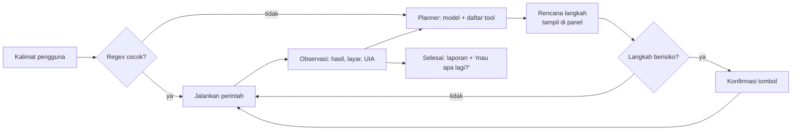
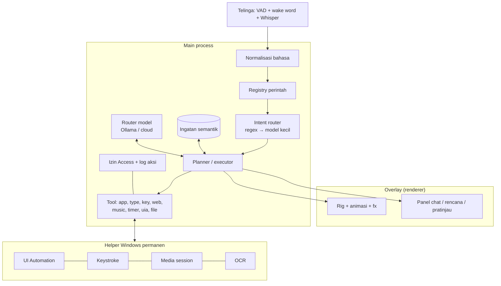

# Capri Desktop — Roadmap

Rencana pengembangan Capri setelah 0.5.8: apa yang perlu diperbaiki dulu supaya proyek ini kokoh, lalu fitur-fitur
besar yang bisa menjadikan dia asisten desktop yang benar-benar pintar. Disusun dari kondisi kode saat ini (bukan
teori): setiap poin "perbaikan" berasal dari bug atau kerapuhan yang memang pernah muncul.

Ukuran kerja: **S** (≤ 1 hari), **M** (2–5 hari), **L** (1–2 minggu), **XL** (lebih dari 2 minggu).

---

## 0. Status di v0.6.0

**Sudah dikerjakan** (versi pertama yang bisa dipakai, belum versi akhir setiap poin):

| Poin | Yang masuk di 0.6.0 |
| --- | --- |
| 2.1 Tes dan CI | `npm test` (34 tes: frasa sehari-hari, lirik, perintah berantai, transkrip suara, router, draft, recall, store, log), `npm run lint` (ESLint, hanya aturan bug), `npm run check:names` (bentrok nama field/method dan variabel PowerShell), `.github/workflows/ci.yml` (Windows: lint, tes, parse + PSScriptAnalyzer). |
| 2.3 Intent router | Kalimat yang terdengar seperti perintah tapi tidak tertangkap regex → model menjawab satu perintah → dibaca lagi oleh regex. Dibatasi: harus sesuai kata-katamu, tidak pernah menutup aplikasi, tidak ada "artis" karangan model. |
| 2.6 Konfigurasi aman | `store.js`: tulis ke `.tmp` lalu rename, `.bak` salinan terakhir yang valid, file rusak disimpan sebagai `.broken-*`. Untuk config, memory, growth log, ringkasan riwayat, log aksi. |
| 2.7 Rilis | Auto-update `electron-updater` dari GitHub Releases (tanya dulu / otomatis / mati), `latest.yml` + blockmap ikut dibangun. |
| 3.2 Asisten menulis | Draft → pratinjau → Ketik / Salin / Ulangi, "lebih singkat" untuk revisi, Shift+Enter di aplikasi chat. |
| 3.4 Telinga | Kosakata (nama aplikasi, kata-katamu, namamu) jadi prompt Whisper; prompt yang "diulang" Whisper saat hening dibuang. |
| 3.6 Ingatan semantik | `recall.js`: BM25 + stemming ID/EN untuk catatan dan obrolan lama; embedding Ollama bila ada model embedding. |
| 3.13 Skill | Perintah buatanmu ("kalau aku bilang mode kerja, …") lewat suara atau Pengaturan › Behavior. |
| 3.14 Integrasi harian | Cuaca (Open-Meteo) dan rangkuman pagi sekali sehari. |
| 3.15 Riwayat aksi | Pengaturan › Access › What she did (tanpa isi yang diketik). Undo belum. |
| Keamanan mengetik | Tolak kotak password (UI Automation + ES_PASSWORD), berhenti saat kamu menekan tombol, tombol Stop. |

**Belum** (tetap seperti rencana di bawah): 2.2 registry perintah, 2.4 helper Windows yang selalu hidup, 2.5 mengetik
tanpa keystroke, 3.1 agen rencana-aksi-periksa, 3.3 kendali aplikasi lewat UI Automation, 3.5 suara, 3.7 router model,
3.8 pencarian web cadangan, 3.9 Spotify Web API, 3.10 lirik lanjutan, 3.11 mesin kepribadian, 3.12 tubuh generasi
berikutnya, plugin (bagian lain 3.13), undo (bagian lain 3.15).

---

## 1. Kondisi sekarang

**Yang sudah kuat**

- Tubuh dan animasi yang khas (rig WebGL, akting pose-to-pose, tubuh elastis, efek fx), overlay yang tetap bisa diklik.
- Banyak indera: jendela di depan, lagu yang diputar (media session Windows), lirik LRCLIB, OCR layar, mikrofon.
- Banyak aksi: buka aplikasi/situs/folder, Spotify, kontrol lagu, mengetik ke aplikasi lain, timer, alarm, game, coding.
- Halaman **Access** untuk izin, otak lokal (Ollama) atau cloud, satu prompt sekali jalan, pencarian web.

**Yang rapuh (dari bug yang benar-benar terjadi)**

| Gejala yang pernah muncul | Akar masalah |
| --- | --- |
| "Hello Capri, pause the music" tidak jalan; "Show the music lyrics" ditulis ulang oleh AI | Perintah dikenali dengan regex raksasa: satu kata di luar daftar (hello, music) = gagal total |
| Alarm menjawab jam; Ctrl+Alt+V mati; chat tidak menjawab | Nama bentrok (`case 'clock'` dua kali, `case 'listen'` dua kali, `this.asked` menimpa method) |
| Mengetik mengirim teks kosong | Variabel PowerShell tidak peka huruf besar/kecil (`$text` = `$Text`) |
| "Hello nnnnnnne", huruf hilang | Keystroke Unicode terlalu cepat untuk Notepad Windows 11 |
| AI bilang "Typed it in Notepad" padahal tidak terjadi | Model tidak tahu batas kemampuannya |
| Bing kosong di aplikasi tapi jalan di Node | Scraping HTML bergantung pada perilaku situs |
| Jawaban basi diulang ("Couldn't find that") | Riwayat chat ikut membentuk jawaban |

Pola besarnya: **tidak ada tes otomatis**, **file sangat besar** (main.js, capri.js, life.js, errands.js ribuan
baris), dan **perintah dikenali hanya dengan pola teks**. Tiga hal ini yang paling banyak menghasilkan bug.

---

## 2. Perbaikan prioritas (lakukan dulu)

### 2.1 Tes otomatis dan CI — **M**, paling penting

- Pindahkan semua suite yang sudah dipakai selama pengembangan ke `test/` dengan `node:test`:
  perintah sehari-hari (73 kalimat), lirik (38), rantai perintah (26), transkrip suara, deteksi pertanyaan web.
- Tes kontrak untuk helper PowerShell (`type.ps1`, `media.ps1`): parse tanpa error, parameter, output JSON.
- **ESLint** dengan aturan yang menangkap bug yang sudah terjadi: `no-duplicate-case`, `no-undef`, `no-dupe-keys`,
  `no-shadow`, `no-dupe-class-members`, plus aturan kustom kecil "properti yang menimpa method kelas".
- **PSScriptAnalyzer** untuk `.ps1` (menangkap variabel yang bentrok dengan parameter).
- GitHub Actions: lint + tes di setiap push; build installer di setiap tag.

### 2.2 Registry perintah, bukan regex di satu file — **L**

Setiap perintah jadi modul kecil:

```js
// src/main/commands/type.js
export default {
  id: 'type',
  access: 'type',
  examples: ['type hello in notepad', 'ketik halo di vscode', 'tulis selamat pagi ke chat'],
  match: (text) => …,            // regex cepat (tetap ada)
  slots: { text: 'string', app: 'app?' },
  run: async ({ text, app }, ctx) => …,
  lines: { done: 'Typed it in {0}.' },
};
```

- `examples` sekaligus jadi data tes, contoh untuk AI, dan dokumentasi README otomatis.
- Normalisasi bahasa di satu tempat (sapaan, nama Capri, "can you/tolong", tanda baca dari suara).
- Nama perintah unik dicek saat startup: bentrok nama tidak mungkin terjadi lagi.

### 2.3 Pengenal maksud cadangan (intent router) — **L**

Regex tetap jalan pertama (cepat, gratis). Kalau tidak cocok dan kalimatnya terlihat seperti perintah, model kecil
lokal memilih perintah dari daftar registry lewat **tool calling / JSON schema**:

```json
{ "command": "type", "args": { "text": "It's free on GitHub", "app": "notepad" }, "confidence": 0.86 }
```

- Ambang keyakinan: tinggi = jalan; sedang = tanya "maksudmu buka Notepad lalu ketik …?" dengan tombol.
- Ini menyelesaikan seluruh kelas bug "kata di luar daftar".

### 2.4 Helper Windows yang selalu hidup — **M**

Sekarang setiap aksi menjalankan PowerShell baru (0,3–0,8 detik per aksi, CPU naik). Ganti dengan satu proses
helper permanen (PowerShell atau .NET kecil) yang menerima JSON-RPC lewat stdin: `type`, `media`, `ocr`,
`windows`, `uia`. Aksi jadi instan, dan satu tempat untuk menangani fokus jendela.

### 2.5 Mengetik tanpa keystroke bila bisa — **M**

- Pakai **UI Automation** (`ValuePattern` / `TextPattern`) untuk memasukkan teks langsung ke kontrol edit: tanpa
  mencuri fokus, tanpa huruf tercampur dengan ketikan pengguna, tanpa "nnnnnnne".
- Keystroke hanya sebagai cadangan, dengan deteksi ketikan pengguna (GetLastInputInfo / raw input): jeda otomatis.
- **Tolak mengetik ke kolom password** (`IsPassword` dari UIA). Penting untuk keamanan.

### 2.6 Konfigurasi aman — **S**

- `config.json` ditulis atomik (tmp + rename) supaya tidak rusak saat PC mati mendadak.
- Data yang terus tumbuh (`tastes`, riwayat, pelajaran) dipindah dari config ke penyimpanan terpisah.
- Migrasi versi config (nomor skema), bukan menebak kunci yang hilang.

### 2.7 Rilis profesional — **M**

- **Auto-update** dengan `electron-updater` (file `latest.yml` sudah dibuat oleh build, tinggal dipakai).
- **Code signing** supaya SmartScreen tidak muncul.
- Workflow rilis otomatis: tag → build → checksum → catatan rilis dari pesan commit → GitHub Release.

---

## 3. Fitur besar

### 3.1 Agen sungguhan: rencana → aksi → periksa — **XL**

Capri yang bisa mengerjakan tugas berlangkah dari satu kalimat bebas, seperti Claude Code tapi untuk desktop:

> "Buat file belanja.txt di Desktop, isi daftar belanja untuk nasi goreng, lalu buka filenya."



- Tool berbentuk JSON schema dari registry perintah (2.2): `open_app`, `type_text`, `press_key`, `search_web`,
  `play_song`, `set_timer`, `read_screen`, `click`, `write_file` (di folder yang diizinkan saja).
- Daftar langkah tampil di panel seperti to-do list, dengan tombol **Batal**.
- Setiap langkah memeriksa hasilnya (jendela muncul? teks masuk?) sebelum lanjut.
- Model: qwen2.5 / llama3.1 untuk tool calling di Ollama, atau model cloud bila pengguna mengizinkan.

### 3.2 Asisten menulis di aplikasi mana pun — **L**

- "Tuliskan email ke bos minta cuti hari Jumat": model menulis, **pratinjau di panel** dengan tombol
  *Ketik* / *Ubah* / *Lebih formal* / *Bahasa Inggris*, lalu diketik ke aplikasi yang aktif.
- **Teks yang diblok**: Capri membaca seleksi (Ctrl+C sementara, clipboard dikembalikan), lalu perintah seperti
  "perbaiki grammar", "terjemahkan", "ringkas", "buat lebih sopan", dan hasilnya menggantikan seleksi.
- Clipboard pintar: "ringkas yang aku copy", "jadikan tabel".

### 3.3 Mengendalikan aplikasi lewat UI Automation — **XL**

- Membaca pohon UI jendela: nama tombol, kolom, menu. "Klik tombol Kirim", "buka menu File", "isi kolom
  pencarian dengan …".
- Untuk aplikasi tanpa UIA (game, canvas): OCR + koordinat, atau model vision untuk "klik tombol biru itu".
- Konfirmasi wajib untuk klik yang tidak bisa dibatalkan (Kirim, Hapus, Bayar), sesuai halaman Access.

### 3.4 Telinga yang lebih baik — **L**

- **Kosakata khusus untuk Whisper** (`initial_prompt`): nama aplikasi (Notepad, GitHub, Antigravity, VS Code),
  nama pengguna, istilah Cyberpunk. Ini perubahan kecil dengan dampak besar pada salah dengar.
- **VAD** (Silero) untuk tahu kapan selesai bicara, bukan sekadar hening.
- **Wake word lokal** sungguhan (openWakeWord) alih-alih mencocokkan teks "Capri".
- Skor keyakinan per kata: kata yang diragukan dikonfirmasi sebelum aksi penting.

### 3.5 Suara yang lebih hidup — **M**

- TTS streaming per kalimat selagi model masih menulis: dia mulai bicara jauh lebih cepat.
- Gerak bibir dari *viseme*, intonasi mengikuti emosi.
- Sesekali ikut menyanyikan baris lirik lagu yang dia suka.

### 3.6 Ingatan semantik — **L**

- Catatan dan riwayat diberi *embedding* (Ollama `nomic-embed-text`), lalu yang relevan diambil per pesan
  (bukan 25 catatan terakhir).
- Ingatan berwaktu: "kemarin kamu bilang lagi capek" → dia menanyakan kabarmu hari ini.
- Halaman ingatan: lihat, edit, hapus, ekspor.

### 3.7 Router model dan anggaran konteks — **M**

- Deteksi VRAM (`nvidia-smi` / `ollama ps`) lalu pilih: satu model untuk semua (VRAM kecil), atau model kecil untuk
  tugas cepat + model besar untuk chat (VRAM cukup).
- Baca `num_ctx` model, hitung token prompt, ringkas riwayat lama otomatis sebelum melebihi batas.
- Statistik di pengaturan: waktu respons, token per detik, model yang dipakai.

### 3.8 Pencarian web yang tahan banting — **M**

- Penyedia berlapis: Wikipedia → Bing → API opsional dengan key pengguna (Brave Search, Tavily, Google
  Programmable Search).
- Sumber ditampilkan di panel sebagai link yang bisa diklik.
- Pertanyaan berita/harga/skor selalu dicari; pertanyaan umum dijawab langsung kalau model yakin.

### 3.9 Spotify Web API (opsional, login PKCE) — **L**

- Antrean, like/simpan lagu, playlist, rekomendasi: "putar playlist chill", "simpan lagu ini".
- **Audio features asli** (energy, valence, tempo): penilaian selera Capri dan ketukan goyangnya memakai data lagu
  sungguhan, bukan tebakan model atau hash judul.
- Tetap opsional: tanpa login, semua yang sekarang tetap jalan lewat media session.

### 3.10 Lirik tingkat lanjut — **M**

- Terjemahan baris lirik (ID ↔ EN) di bawah baris aslinya.
- Mode karaoke per kata bila tersedia; jendela lirik penuh yang bisa digulir.
- Komentar Capri tentang makna lagu saat diminta ("lagu ini tentang apa?").

### 3.11 Mesin kepribadian — **L**

- Model mood (valensi/energi) yang naik-turun dari kejadian: dipuji, diabaikan, lagu favorit, larut malam.
- Mood memengaruhi pilihan kata, animasi, dan inisiatifnya (lebih jahil saat senang, cuek saat bosan).
- Rutinitas harian: menyapa pagi, mengingatkan istirahat, "laporan hari ini" malam hari.

### 3.12 Tubuh dan animasi generasi berikutnya — **XL**

- **Fisika rambut**: rantai pegas (verlet) untuk setiap duri rambut, bereaksi pada gerakan dan angin kursor.
- **IK** untuk tangan: benar-benar memegang tepi jendela, menunjuk tepat ke tombol.
- **Behavior tree / utility AI** untuk memilih kegiatan diam (bukan acak): tergantung mood, jam, aktivitasmu.
- Sistem ekspresi wajah (kedip, pupil, mulut) di rig, bukan hanya gambar potret.
- Partikel glitter di GPU, mode hemat daya otomatis saat baterai.

### 3.13 Sistem plugin dan skill — **XL**

- Perintah buatan pengguna tanpa coding (JSON/YAML): kalimat pemicu → urutan aksi.

  ```yaml
  name: mode kerja
  say: ["mode kerja", "aku mau fokus"]
  do:
    - open: vscode
    - media: pause
    - timer: 50m
    - reply: "Fokus. Aku awasi."
  ```

- Plugin JavaScript dalam sandbox dengan izin dari halaman Access.
- Galeri skill dari komunitas (repo GitHub sebagai sumber).

### 3.14 Integrasi harian — **L**

- Kalender (file ICS / Google / Outlook): "ada jadwal apa hari ini?", pengingat otomatis.
- Cuaca (open-meteo, tanpa key), ringkasan berita pagi.
- Notifikasi Windows yang dia bacakan dan rangkum.

### 3.15 Riwayat aksi dan undo — **M**

- Log "apa yang Capri lakukan" (buka, ketik, tekan, cari) dengan waktu dan aplikasinya.
- Undo bila mungkin (Ctrl+Z di aplikasi yang tadi diketik, tutup aplikasi yang baru dibuka).
- Ekspor log untuk laporan bug.

---

## 4. Urutan pengerjaan

| Fase | Isi | Hasil |
| --- | --- | --- |
| **0. Fondasi** (2–3 minggu) | 2.1 tes + CI, 2.6 config aman, 2.4 helper permanen, 3.4 kosakata Whisper, 2.7 auto-update | Bug lama tidak kembali; aksi instan; salah dengar berkurang drastis |
| **1. Perintah pintar** (3–4 minggu) | 2.2 registry, 2.3 intent router, 2.5 mengetik lewat UIA, 3.15 riwayat aksi | Kalimat bebas dimengerti; mengetik tidak pernah salah |
| **2. Agen** (4–6 minggu) | 3.1 planner, 3.2 asisten menulis, 3.7 router model, 3.8 pencarian berlapis | Tugas berlangkah dari satu kalimat |
| **3. Kendali aplikasi** (4+ minggu) | 3.3 UI Automation, 3.6 ingatan semantik | "Klik tombol Kirim", ingat konteks berminggu-minggu |
| **4. Hidup** (berkelanjutan) | 3.5 suara, 3.9 Spotify API, 3.10 lirik, 3.11 kepribadian, 3.14 integrasi | Terasa seperti teman, bukan alat |
| **5. Tubuh & ekosistem** | 3.12 animasi, 3.13 plugin | Pembeda utama dari asisten lain |

Ketergantungan penting: **3.1 butuh 2.2** (tool berasal dari registry), **3.3 butuh 2.4** (helper permanen),
**3.2 butuh 2.5** (mengetik yang andal).

---

## 5. Arsitektur target



---

## 6. Ukuran keberhasilan

- **Perintah dikenali**: ≥ 95% dari suite kalimat (teks dan transkrip suara), diukur di CI.
- **Mengetik**: 0 karakter salah di Notepad, VS Code, Chrome, Discord pada tes 1.000 karakter.
- **Latensi**: perintah lokal < 300 ms; jawaban pertama (token pertama) < 1,5 s dengan model lokal yang sudah dimuat.
- **CPU saat diam**: < 1% (tanpa musik), < 3% (dengan musik dan lirik).
- **Regresi**: setiap bug yang diperbaiki punya tes yang mencegahnya kembali.

---

## 7. Quick wins (bisa minggu ini)

1. Kosakata `initial_prompt` untuk Whisper (nama aplikasi, GitHub, Antigravity, nama pengguna). **S**
2. ESLint dengan `no-duplicate-case` + `no-dupe-class-members` + PSScriptAnalyzer di CI. **S**
3. Suite tes yang sudah ada dipindah ke `test/` dan dijalankan `npm test`. **S**
4. `config.json` atomik. **S**
5. Tolak mengetik ke kolom password (UIA `IsPassword`). **S**
6. Auto-update dengan `electron-updater` dari GitHub Releases. **M**
7. Tombol "Batal" saat Capri sedang mengetik atau menjalankan rantai perintah. **S**
