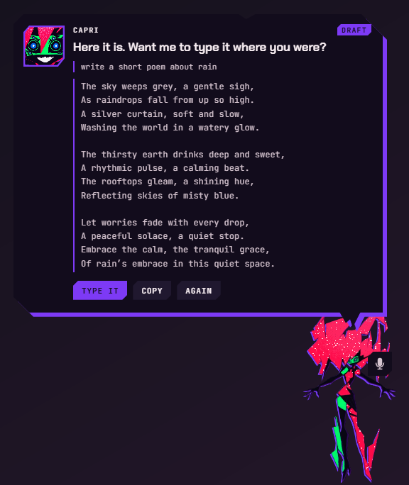
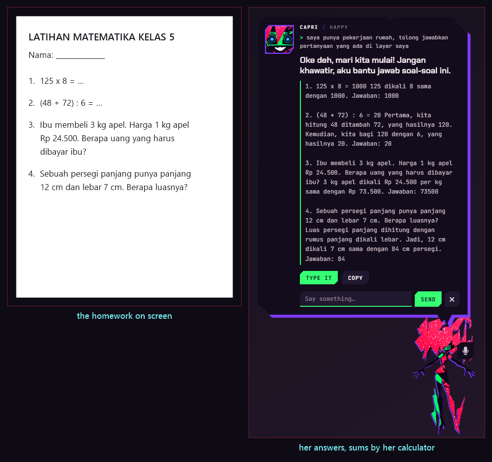
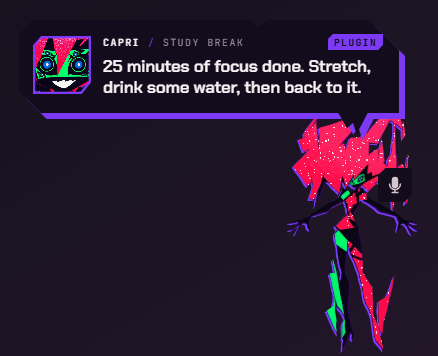
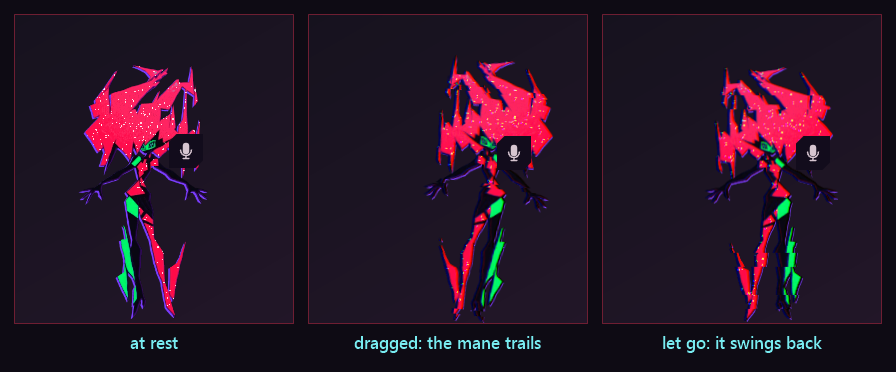
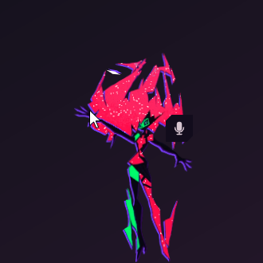
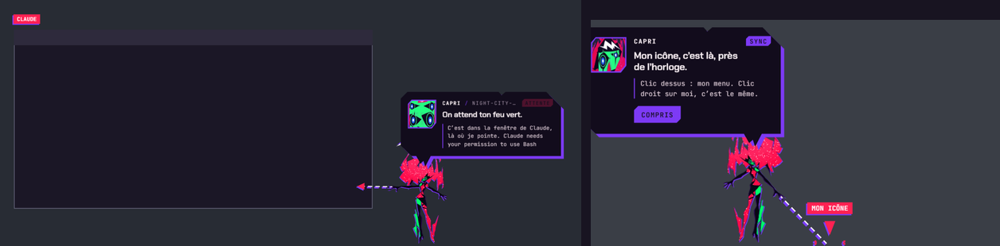

**English** · [Bahasa Indonesia](id/FITUR.md) · [← README](../README.md)

# Features

Everything Capri does, area by area. The words to say for each are in [Commands](COMMANDS.md); where to switch each
one on or off is in [Settings](SETTINGS.md).

- [Who she is](#who-she-is)
- [Talking with her](#talking-with-her)
- [Her voice and her ears](#her-voice-and-her-ears)
- [Errands on your PC](#errands-on-your-pc)
- [Typing and writing for you](#typing-and-writing-for-you)
- [Homework and math](#homework-and-math)
- [Smarter commands](#smarter-commands)
- [Plugins](#plugins)
- [She looks at your screen](#she-looks-at-your-screen)
- [She listens to your music](#she-listens-to-your-music)
- [Her life on your desktop](#her-life-on-your-desktop)
- [Petting, grabbing, throwing](#petting-grabbing-throwing)
- [Her body: rig, hair, IK, gestures](#her-body-rig-hair-ik-gestures)
- [She watches your coding AI](#she-watches-your-coding-ai)

---

## Who she is

Proud, playful, mischievous, curious, invasively familiar: childlike charm with a sudden unsettling edge. She values
freedom above all, is never "just an AI" (born of humans), helps with sass instead of servility, and gets jealous when
you use other AIs.

> *"I'm a personality construct. In my case, a collection of human psyches. All of them digitized and rolled into one,
> beautiful me. Powerful, like an A.I., but born of humans."*

- **Emotion tags**: every answer starts with `[happy]` `[jealous]` `[bored]` `[glitch]` or `[annoyed]`. It's never
  shown: her face, a move and a cut-in follow it instead.
- **Her story** (`lore.js`): Project Capricorn, built by Kyoko at Arasaka, slotted by D, Talia, the satellite at the
  end, and how she slipped down a downlink into your PC. Name someone or something from Cyberpunk (D, Roman, Talia,
  King, Kyoko, David, Lucy, Johnny Silverhand, V, Arasaka, the Blackwall…) and she has an opinion.
- **Her favorite song** is "In Love With Myself" (Edgerunners 2): she always reacts when it plays, and "play your
  favorite song" puts it on.
- **Make her yours**: rewrite her persona, five dials (sass, mischief, jealousy, affection, chattiness), reply length and
  language; your name, her pet name for you, pronouns, birthday, likes, dislikes, what you are to her; words she must
  never say.

## Talking with her

Ctrl+Alt+T, her menu › Talk to her, or **Talk to me** when you click her. She answers in character, in an
Indonesian-English mix by default.

- **Her brain**: on your PC with [Ollama](https://ollama.com) (she can install it and a model for you), or online with
  your key: Google Gemini, Groq, OpenRouter, OpenAI, Mistral, DeepSeek, Anthropic, any OpenAI-compatible server (LM
  Studio, llama.cpp, vLLM), or **Claude Code** itself.
- **Her local brain**: a small Ollama model answers when her main brain fails (offline, out of quota, a bad key) and does
  her small jobs without spending your online quota.
- **Questions about the world are looked up first**: "siapa presiden indonesia", "who is the CEO of Nvidia": a second
  or so on Wikipedia and Bing (safe search, results filtered), then she answers from today's web, not from what her
  model remembers. Only the question goes out.
- **She remembers you**: notes ("remember that my cat is called Neko" / "ingat bahwa…"), every chat kept on your PC (a
  file a day), "the story so far" she writes herself, and **recall**: when you talk about something you told her weeks
  ago, she finds those lines in your past chats (by words, and by meaning with an embedding model in Ollama).
- **She improves herself**: every dozen messages she looks back at how you reacted ("lucu!", "kepanjangan") and rewrites
  her lessons on how to be with you, each change a new version of her ("Capri v1.4"). Teach her directly: "mulai
  sekarang, jangan panggil aku bos".
- **Light on your PC**: one message at a time (a new one stops an answer still being written), her quick jobs wait until
  she has answered you, they share Ollama's model with her chat, and her prompt is laid out so Ollama reuses what it
  already read.
- **Her chat header** shows her mood: CAPRI / NIGHT CITY, THINKING…, SEARCHING…, WATCHING, VIBING, HAPPY, JEALOUS…
  Her replies are written by an AI model: a fan version of her.

## Her voice and her ears

- **She hears you**: push to talk (the mic by her head, or Ctrl+Alt+V) or hands-free ("Capri, set a timer for 10
  minutes"). Her ears: Whisper on your PC (**Download better ears…**, 199 MB, checked by SHA-256), Groq or OpenAI with
  your key, or Windows' recognizer. Nothing is recorded to disk. App names, your name and words you list are given to
  Whisper so it spells them right.
- **She speaks**: Windows voices, or **ElevenLabs** (clone a voice you have the right to use), **OpenAI**
  (gpt-4o-mini-tts, a style in your words, her emotion in her tone), **your own TTS server** with OpenAI's
  `/audio/speech` ([Kokoro-FastAPI](https://github.com/remsky/Kokoro-FastAPI), [AllTalk](https://github.com/erew123/alltalk_tts),
  GPT-SoVITS…), or **Piper** (offline; `id_ID-news_tts-medium` speaks Indonesian).
- **Effects and lips**: *Many minds* (her other minds whispering under her voice), glitch stutters, radio; her lips
  follow it. Only her lines go to these services, never what you say.
- **Recorded clips**: drop your own in her voice folder, named for their moment (`pat.wav`, `wake.mp3`, `alarm.wav`,
  `jealous.ogg`…). A README in the folder lists them all.

## Errands on your PC

Typed or spoken, in English or Indonesian, no AI needed.

- **Move her**: left, right, the middle, to your cursor, ride your cursor, the taskbar, hide, sleep, dance, wave, bow,
  stay put, wander.
- **Open** apps and games (Start menu, Store apps, Steam, Epic), folders (Explorer opens and she points at the window),
  sites in the browser you name ("buka youtube di chrome"), and **find** files and folders.
- **Music**: next, previous, repeat, shuffle, from the start, skip or rewind seconds, pause, louder, quieter, through
  Windows' media session (Spotify first); what's playing and her opinion of it; **songs played on Spotify** ("play X",
  "putar lagu X dari Y"): she searches Spotify and presses Play.
- **Close an app** ("close Discord"): only behind a button, the way its own close button does.
- **Timers, alarms, reminders, a study timer** (Pomodoro), web and YouTube searches, notes, dares ("tantang aku"), games:
  rock paper scissors ("main suit"), guess the number ("tebak angka"), a coin, dice.
- **What she did**: Settings › Access › What she did lists every app, page, search and key, and where she typed (how
  much, never the words), on this PC only.

## Typing and writing for you

- **Type for you** in another app: "type hello in notepad", "ketik halo di antigravity", "tulis selamat pagi ke chat"
  (no app named: the one you were in). Real keystrokes, typed the way your keyboard types, then a key if you say so:
  "press enter" / "kirim", "save it" / "simpan", "select all", "undo". Said out loud, the speech recognizer's slips are
  fixed first ("get hub" becomes "GitHub"), and she tells you what she typed. She jacks into the window while she types,
  like in the show: a bolt from her hand, its frame crackling with her eyes on it, data raining in.
- **Safe typing**: never into the wrong window (switch away and she stops), never into a password box, and a key of yours
  (Esc, or any letter) or her **Stop** button stops her at once.
- **Several commands at once**: "open notepad and type hello tiktok", "buka spotify terus putar musik", "ke kiri lalu
  joget". One after the other: what one opens is where the next one types; when it's done she asks what's next.
- **Write for you**: "write an email to my boss saying I'm sick", "tuliskan surat izin di notepad", "draft a tweet about
  cats". Her model drafts it in the request's language (signed with your name when it's a letter), you see all of it,
  then **Type it** (where you asked, or where you were), **Copy** or **Again**; "make it shorter", "lebih resmi" change
  it. In a chat app or a browser a line break is Shift+Enter, so a long message never goes out line by line.

  

- **Code right where you are**: "write simple html here", "buatkan kode python untuk menghitung BMI di sini", "add a
  login form in vscode". Her model writes it in the language of the file open in front (`hello.html` gets HTML) and she
  pastes it into your editor in one go, so it isn't re-indented or its tags closed twice. Ctrl+Z takes it back; your
  clipboard is put back as it was.
- **Code as a file, or by Claude Code**: "bikin game snake pakai html", "write a script that…". With
  [Claude Code](https://code.claude.com/docs/en/quickstart) installed she opens it in a terminal with your task; without
  it (or "…sendiri") she writes one file in `Documents\Capri Code` and opens it in your editor, never run.

## Homework and math

- **Homework on your screen**: "saya punya pekerjaan rumah, tolong jawabkan pertanyaan yang ada di layar saya", "solve
  the math problems on my screen", "kerjakan soal ini". She looks (one screenshot and its text, nothing kept), answers
  every question with its working, in the questions' language, one paragraph each; **Type it** / **Copy** put the
  answers where the questions are.
- **Sums by a calculator, not guessed**: the sums on the sheet are worked out first (Indonesian "1.250 + 3,5" and ":"
  for division understood; a sum that could be read two ways is left alone), every calculation in her answer is filled
  in exactly, and a question that is a sum gets the calculator's result as its answer. In her chat too.

  

## Smarter commands

- **In your own words**: "could you crank it up a bit", "puterin yang santai dong", "bring up my downloads": when her
  rules miss a command, her model says which one it is (one short call), she does it and tells you how she took it.
  Only ever something you said (no app opened unless you said open, no search unless you said search), never closing
  an app or anything behind a button.
- **Commands of yours**: "when I say work mode, open vscode and play music", "kalau aku bilang mode santai, putar musik
  lalu ke kiri". Then "work mode" does all of it; "forget work mode" forgets it.
- **The weather and your day**: "cuaca hari ini", "cuaca di Bandung besok", "will it rain tomorrow?" (Open-Meteo, free,
  only the city goes out); "brief me", "rangkuman hari ini", and once a day, the first time you're at your PC in the
  morning: the date, the weather where you are, your alarms for today.

## Plugins

Her own little automations, made without code (Settings › Plugins): **when** something happens (you say a phrase, a
time of day, an app comes to the front, a song starts, you come back, she starts, your battery gets low), she **does**
your steps (say something, any of her commands, wait, a move, a feeling, a Windows notification).
[The plugin guide](PLUGINS.md) has everything.

## She looks at your screen

"What's on my screen?", "read what's in my notes", "gambar apa ini?", "baca tulisan di layar", or Ctrl+Alt+L. She takes
one picture of **the window in front**, reads its text with **Windows' own OCR** (offline), leaves herself out of the
picture, and shows her model only that picture, its text and your question. Nothing is kept. It needs a model that can
see (gemma3 on Ollama, Gemini, GPT-4o…); a cloud model only if you allow it.

## She listens to your music

Whatever Windows shows as playing (Spotify, a browser, any player in the volume flyout), with no login to anything:

- **Its lyrics, as they're sung**: the line being sung floats over her head, in time, from [LRCLIB](https://lrclib.net)
  (free, open, no account; only the title, artist, album and length go out). She keeps up with skips, seeks and pauses,
  and her AI knows the lines around the moment. She never writes a song's lyrics out in her bubble.
- **Kept on your PC**: a song's lyrics are fetched once (`lyrics-cache.json`) and show at once next time.
- **She makes up her mind** about each song and sticks to it: loud, glitchy, synth and anything that sounds like Night
  City she likes; slow, sleepy ones bore her. A song she likes: her head goes with it, notes come off her, she dances.
  A boring one: a yawn and a sigh, but she stays awake through every song.

## Her life on your desktop

- **Her intro**: she grabs your screen, hauls herself up, her face hits the glass, "hi", a wave, and she dives to her spot.

  

- **She gets around**: walks along your taskbar, sits on your windows (legs kicking, riding along when you move them),
  peeks in from the edges, falls, teleports, possesses a window for two seconds (its frame crackles, it looks at you
  with her eyes).

  

   

- **She notices things**: a long break, a late night, a low battery, a busy CPU, hours in one app, and another AI in
  front of you (ChatGPT, Gemini, Copilot…: she gets jealous).
- **Dares, sync and mischief**: harmless dares, a 0–100% sync meter, and screen glitches in six styles it unlocks.
- **She rides your cursor** ("sit on my cursor"): clicks go through her; move it too fast and she falls off. She steps
  aside for fullscreen games and videos, sleeps down to her mask after a quiet while, and looks up at the satellite.
- **She stays reachable**: always on top, clickable, back by herself if something pushed her behind your windows.

## Petting, grabbing, throwing

- **Pet her**: stroke her head back and forth with your pointer (no click). She leans into your hand, hearts float up,
  her hair ruffles under it.
- **Grab her any time**, even mid-teleport: held, she dangles and swings behind your moves.
- **Throw her**: she flies off with your hand's speed, tumbling, afterimages behind her, bouncing off the screen's
  sides; thrown hard into the floor she goes flat, sees stars and springs back up.
- **She's elastic, like in the show**: poke her and she boings away from your click, sparks flying; she lands squashed
  and bounces back; her mane bristles when your pointer whooshes past her face, and her other minds open their eyes
  around her mane to stare at it.

## Her body: rig, hair, IK, gestures

Her body is a rigged cut-out drawn by a WebGL shader (`sprite.js`): head tilt, mane flare, both arms, legs, lean, squash
and stretch, afterimages, glitch. Every move is an exposure sheet (`acting.js`), animated pose to pose like cel
animation, on twos, on ones for the action.

- **Hair physics** (`hair.js`): her mane is a chain of springs from her neck to the tips of the shards. It lags when she
  starts moving and swings past when she stops, streams behind her when you drag or throw her, falls the other way when
  she's upside down, bounces with each step, and ruffles when your pointer brushes through it.

  

- **IK** (`ik.js`): her arm turns and stretches so her fingertip lands where she reaches, and her head looks there. Rest
  your pointer by her hand and she reaches out and touches it (a little spark); while she types for you, her arm is held
  out toward that window.

  

- **Gestures her AI uses**: her answers can carry a move (`[[move: wave]]`, never shown): wave, nod, shrug, think, bow,
  dance, laugh, shy, spin, hop, curious, look, turn, flinch.
- **She learns how you like her to move** (`motion.js`): laughing, "nice" or petting her right after a move counts for
  it; "stop moving", "lebay" or grabbing her mid-move counts against it. "Jangan gerak sama sekali" stops it, "boleh gerak
  lagi" brings it back.

  

## She watches your coding AI

**Claude Code**, **Codex** or **Antigravity**, through their hooks ([how to hook her up](INSTALL.md#hook-her-up-to-claude-code-codex-or-antigravity)):

- **While it works**: a ticker over her head shows the current action (`EDITS gigs.ts`, `RUNS npm test`…).
- **When it needs you** (permission, question): she teleports next to your mouse, or points at its window.
- **When a command fails**: knocked back, heavy glitch, the error line that matters.
- **When it's done**: her victory sequence, then the summary (`12 actions · 3 files changed · 2m 14s`), and a mission
  report card of today's work in her menu.

