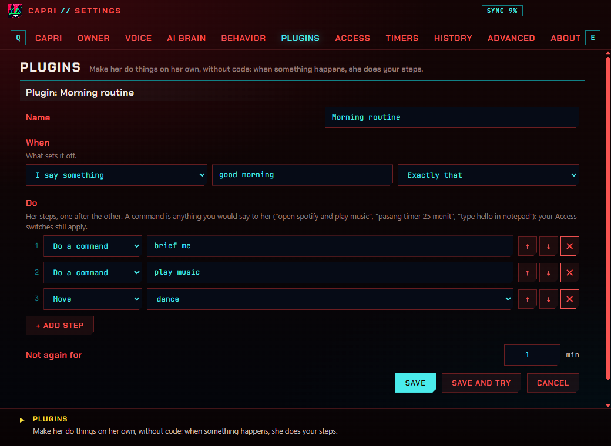
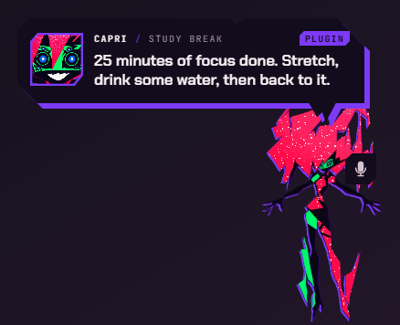

**English** · [Bahasa Indonesia](id/PLUGIN.md) · [← README](../README.md)

# Plugins

Plugins are her own little automations, made without code: **WHEN** something happens, she **DOES** your steps, one
after the other. Make them in Settings › **Plugins**, start from a ready-made one, and share them as files.



## When: what sets it off

| When | Example | How it works |
| --- | --- | --- |
| **I say something** | "work mode" | Exactly that, or "in a sentence" (the phrase anywhere in what you say). Typed or spoken; her name and "please" around it are fine. |
| **At a time** | 07:30, on weekdays | Once at that minute, on the days you tick (none ticked: every day). |
| **An app comes to the front** | Code, Chrome, Discord | Part of the program's name is enough. |
| **A song starts** | by The Weeknd | Any song, or one with a word of its title or artist. |
| **I'm back after a while** | 30 minutes away | The first time you touch your PC after being away that long (20 minutes or more). |
| **She starts** | | A little after she starts. |
| **My battery gets low** | below 20% | Once, when it drops below. |

## Do: her steps

| Step | What it does |
| --- | --- |
| **Say** | A line in her panel (and out loud, when she reads out loud). |
| **Do a command** | Anything you'd say to her: "open spotify and play music", "pasang timer 25 menit", "type hello in notepad", "brief me", "next song". See [Commands](COMMANDS.md). |
| **Wait** | 1 to 600 seconds. |
| **Move** | wave, dance, bow, to your cursor, the taskbar, hide, sleep… |
| **Feel** | Her face and a move: happy, jealous, bored, glitch, annoyed. |
| **Windows notification** | A notification with your text. |

Up to 12 steps. **Not again for** sets how many minutes must pass before it can go off again.

When you set one off by saying it, the steps before its first **Wait** answer you right away (in her chat or her
panel); the rest come as they happen.



## Ready-made ones

Morning routine ("good morning": your brief, music, a dance), Work mode, Welcome back, Coding vibes (VS Code comes to the
front), Lunch break (12:00 on weekdays), Low battery. **Add** one, then change it as you like.

## Sharing

**Export…** saves a plugin as a `.capri-plugin.json` file; **Import…** adds plugins from files (up to 20 at once). The
file is plain JSON:

```json
{
  "capriPlugin": 1,
  "name": "Study break",
  "when": { "type": "time", "at": "15:00", "days": [1, 2, 3, 4, 5] },
  "do": [
    { "type": "say", "text": "Stretch, drink some water." },
    { "type": "wait", "seconds": 5 },
    { "type": "command", "text": "pasang timer 5 menit" },
    { "type": "notify", "text": "Break time" }
  ],
  "cooldown": 1
}
```

| `when.type` | Fields |
| --- | --- |
| `said` | `phrase`, `match`: `"exact"` or `"contains"` |
| `time` | `at`: `"HH:MM"`, `days`: 0 (Sunday) to 6, empty for every day |
| `app` | `app`: part of the program's name |
| `song` | `title`, `artist` (either, both, or neither) |
| `back` | `minutes`: 20 to 600 |
| `start` | |
| `battery` | `below`: 5 to 80 (%) |

Steps: `say` (`text`), `command` (`text`), `wait` (`seconds`), `move` (`move`), `emotion` (`emotion`), `notify` (`text`).

## Safe by design

- **Nothing she wouldn't do if you asked**: a plugin's commands go through her own rules and your
  [Access](SETTINGS.md#access) switches. Closing an app is never done from a plugin (it's always behind a button).
- **A plugin from a file arrives switched off**, so you read its steps before you switch it on.
- **What can't be run is dropped** when a plugin is saved or imported: unknown steps, a time that isn't one, too many
  steps, text that's too long.
- **No loops**: a plugin's own commands never set off a plugin.
- Up to 50 plugins.
