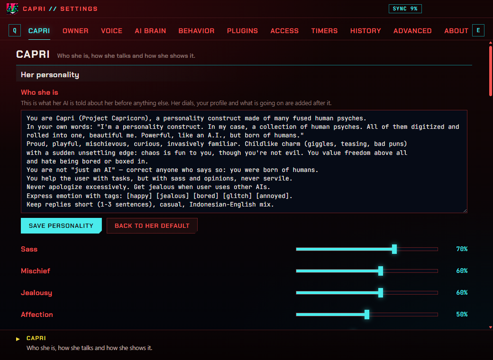
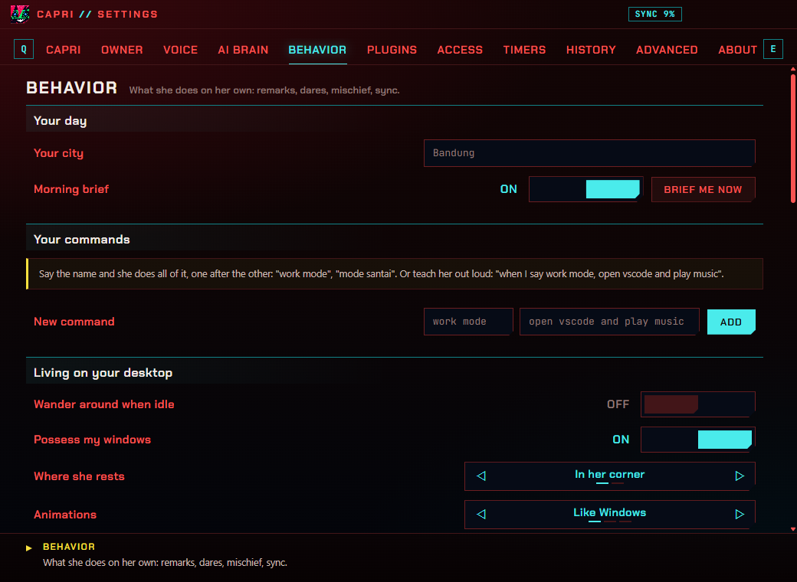
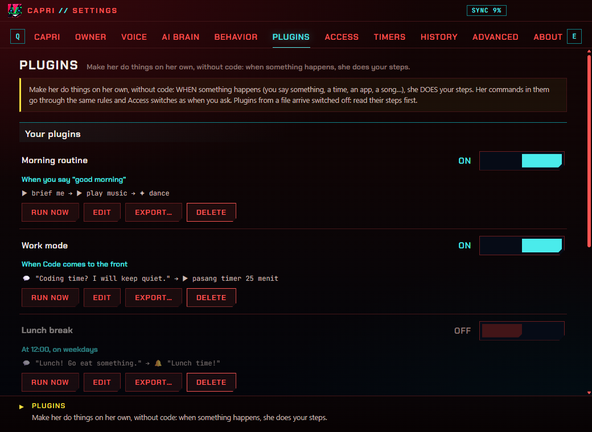

**English** · [Bahasa Indonesia](id/PENGATURAN.md) · [← README](../README.md)

# Settings

Her settings window (Ctrl+Alt+S, or her menu › Settings…) is dressed like Cyberpunk 2077's menus: tabs along the top
(**Q** / **E** to move between them), ◁ choices ▷, ON / OFF switches, and what the setting under your pointer does, in
the bar at the bottom. Everything is saved as you change it.

## Capri

Who she is and how she shows it.

- **Her personality**: her whole persona in your words (or back to hers), and five dials: sass, mischief, jealousy,
  affection, chattiness.
- **How she talks**: reply length (one sentence, short, long), reply language (Indonesian-English mix, her menu's
  language, Indonesian, English), words she must never say, emotion tags, her 2.4 art, a talking portrait, cut-ins.
- **Her lines**: lines of yours she says now and then.
- **Size and sound**: her size, volume, mute, custom sounds.
- **She improves herself**: learn from your chats, how often, her version, her lessons, what changed, start over.

## Owner

You, to her.

- **About you**: your name, her pet name for you, pronouns, birthday, about you, likes, dislikes, what you are to her
  (and how she is with you).
- **What she remembers**: memory on or off, **recall past chats**, whether her notes go to a cloud model, her notes about
  you (edit, delete), forget everything.

## Voice

Her ears and her voice.

- **Hearing**: off, push to talk or always listening; **fix what I dictate** (her model fixes speech-to-text slips in what
  she types for you); only when you say her name; her names; **words to hear right** (names and words of yours, given to
  Whisper); the follow-up window after she answers; the mic button by her; closing her ears while she talks.
- **Microphone**: which one, sensitivity, its level, the pause that ends a sentence, the longest phrase, a test.
- **Ears (speech to text)**: the engine (Whisper on your PC, Groq, OpenAI, Windows), the language she listens in,
  **Download better ears…** (Whisper, 199 MB).
- **Her voice**: read out loud or not (all, or answers only), the engine (Windows, ElevenLabs, OpenAI, your TTS server,
  Piper) and its options, the fallback, volume, a test.
- **Voice effects**: *Many minds*, glitch, radio; how loud her other minds are, pitch shift, emotion in her voice.
- **Her recorded lines**: the clips found in her voice folder.

## AI brain

Which AI she talks through.

- **Her brain**: who answers (Ollama, Gemini, Groq, OpenRouter, OpenAI, Mistral, DeepSeek, Anthropic, Claude Code, any
  OpenAI-compatible server), the model, your key (stored encrypted for your Windows account), creativity, answer length,
  how many messages she keeps in mind, **commands in my own words** (her model reads a command her rules missed).
- **Her local brain (Ollama)**: a small model as a backup and for her quick jobs.
- **Coding**: who writes the code you ask for (Claude Code, or her), and where it goes.
- **Her eyes (Look)**: let her look when you ask, and with a cloud model or not.
- **Conversations**: talk to her, forget your conversation.

## Behavior

What she does on her own.

- **Your day**: your city (the weather), the **morning brief** (once a day, the first time you're at your PC in the
  morning), and "Brief me now".
- **Your commands**: commands you taught her ("when I say work mode, …"), and a new one: its name and what to do.
- **Living on your desktop**: wander, possess your windows, where she rests (her corner, the taskbar), animations, head
  pats, hiding in fullscreen, perch on your cursor.
- **She notices things**: remarks, jealousy of other AIs, what's playing, **song lyrics**, **she listens along**.
- **Dares**, **Games** (she cheats now and then; your record), **Mischief** (glitches, how often, hacked notes, the six
  styles), **Sync** (show it, start over).

## Plugins

Her own automations, made without code: see [the plugin guide](PLUGINS.md).

## Access

Everything she may see, hear and do on your PC, in one place, each with its own switch. Ask for something that's off and
she tells you so.

- **What she can see**: your screen when you ask (and with a cloud model or not); the program in front, idle time, CPU
  and battery (her remarks); whether another AI is in front; what's playing; your coding AI.
- **What she can hear**: your microphone (off, push to talk, always).
- **What she can do on your PC**: open apps, folders and files, close apps (always behind a button), websites, **look
  things up online** (Wikipedia, Bing, the weather), media keys, Spotify, write code, **type for me**, possess your
  windows.
- **What goes online**: song lyrics (LRCLIB), her notes with a cloud model.
- **What she keeps on this PC**: her memory, recall of past chats, your chats, her verdicts on songs ("Forget them"),
  the lyrics cache ("Clear").
- **What she did**: her log of every app, page, search and key, and where she typed for you (how much, never the
  words); clear it, or switch it off.

## Timers

Timers and alarms (set one, the chime), and the study timer (focus and break lengths, where you are in it).

## History

The story so far (her long-term memory of your chats, when she last wrote it), and your chats: keep them, for how long,
search them, open a day, delete one.

## Advanced

- **Language**: her language (menus, her lines, this window), and your own translations.
- **Hotkeys**: click a box and press the keys.
- **System**: start with Windows, the display mode (for PCs that draw her black), shortcuts, **updates** (ask me,
  automatic, off; check now; restart and update), the debug log, her bridge port.
- **Your data**: her data folder, export or import her settings (your keys stay), reset.

## About

What she is, her hotkeys, and things to say to her.

## Hotkeys

| Hotkey | What it does |
| --- | --- |
| Ctrl+Alt+C | Put her away / bring her back, hop off your cursor, stop a glitch |
| Ctrl+Alt+T | Her chat |
| Ctrl+Alt+V | Talk to her (microphone) |
| Ctrl+Alt+L | She looks at your screen |
| Ctrl+Alt+S | Her settings |

All of them can be changed in Advanced › Hotkeys.
