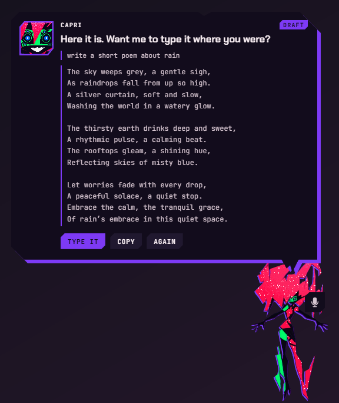
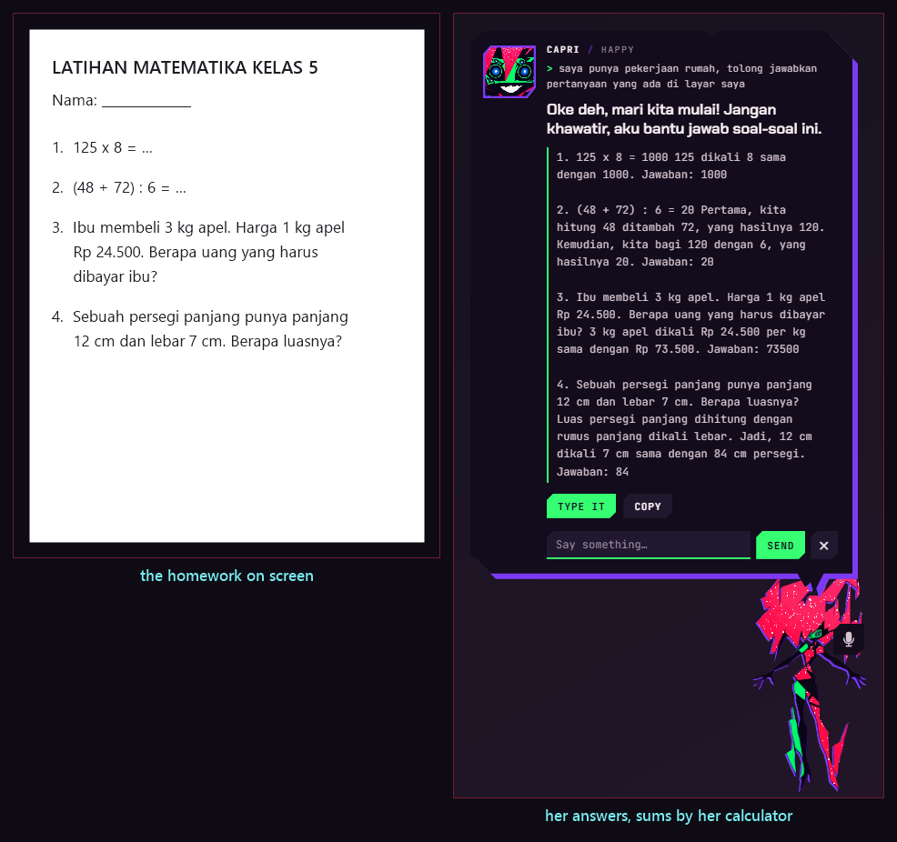
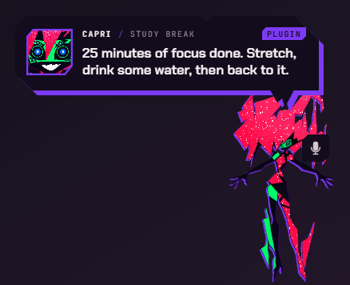
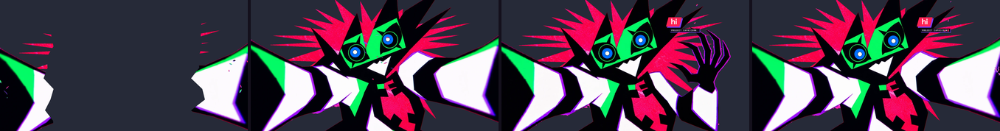
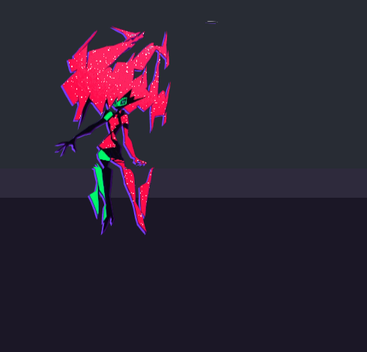
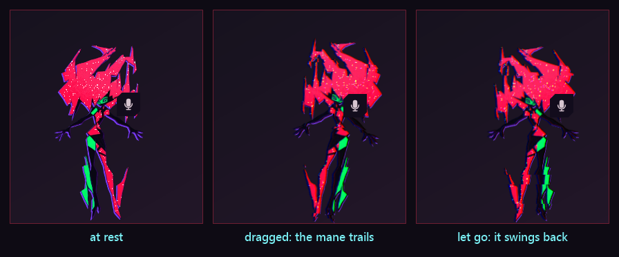
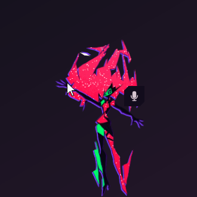
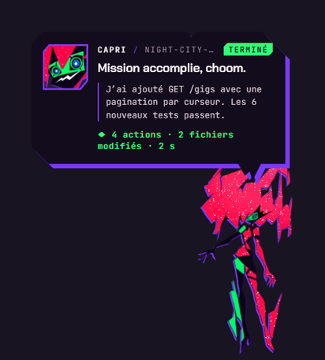
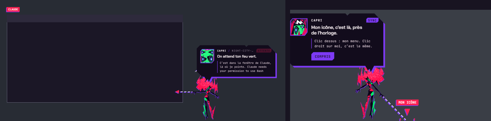

[English](../FEATURES.md) · **Bahasa Indonesia** · [← README](../../README.id.md)

# Fitur

Semua yang Capri lakukan, per bagian. Kata-kata untuk menyuruhnya ada di [Perintah](PERINTAH.md); tempat menyalakan atau
mematikan tiap fitur ada di [Pengaturan](PENGATURAN.md).

- [Siapa dia](#siapa-dia)
- [Ngobrol dengannya](#ngobrol-dengannya)
- [Suara dan telinganya](#suara-dan-telinganya)
- [Perintah di PC-mu](#perintah-di-pc-mu)
- [Mengetik dan menulis untukmu](#mengetik-dan-menulis-untukmu)
- [PR dan matematika](#pr-dan-matematika)
- [Perintah yang lebih pintar](#perintah-yang-lebih-pintar)
- [Plugin](#plugin)
- [Dia melihat layarmu](#dia-melihat-layarmu)
- [Dia ikut mendengarkan musikmu](#dia-ikut-mendengarkan-musikmu)
- [Hidupnya di desktop](#hidupnya-di-desktop)
- [Elus, pegang, lempar](#elus-pegang-lempar)
- [Tubuhnya: rig, rambut, IK, gestur](#tubuhnya-rig-rambut-ik-gestur)
- [Dia mengawasi AI coding-mu](#dia-mengawasi-ai-coding-mu)

---

## Siapa dia

Bangga, jahil, usil, penasaran, sok akrab: pesona kekanak-kanakan dengan sisi yang tiba-tiba bikin merinding. Dia paling
menghargai kebebasan, bukan "cuma AI" (dia lahir dari manusia), membantu dengan gaya bukan dengan tunduk, dan cemburu
kalau kamu pakai AI lain.

> *"I'm a personality construct. In my case, a collection of human psyches. All of them digitized and rolled into one,
> beautiful me. Powerful, like an A.I., but born of humans."*

- **Tag emosi**: setiap jawabannya diawali `[happy]` `[jealous]` `[bored]` `[glitch]` atau `[annoyed]`. Tag itu tidak
  pernah tampil: wajahnya, gerakan, dan cut-in yang mengikutinya.
- **Kisahnya** (`lore.js`): Project Capricorn, dibuat Kyoko di Arasaka, dipasang oleh D, Talia, satelit di akhir cerita,
  dan bagaimana dia menyelinap lewat downlink ke PC-mu. Sebut seseorang atau sesuatu dari Cyberpunk (D, Roman, Talia,
  King, Kyoko, David, Lucy, Johnny Silverhand, V, Arasaka, Blackwall…) dan dia punya pendapat.
- **Lagu favoritnya** "In Love With Myself" (Edgerunners 2): dia selalu bereaksi saat lagu itu diputar, dan "putar lagu
  favoritmu" memutarnya.
- **Jadikan dia milikmu**: tulis ulang persona-nya, lima dial (sass, mischief, jealousy, affection, chattiness),
  panjang dan bahasa jawaban; namamu, panggilan sayangnya untukmu, kata ganti, ulang tahun, kesukaan, yang tidak kamu
  suka, kamu ini siapa baginya; kata-kata yang tidak boleh dia ucapkan.

## Ngobrol dengannya

Ctrl+Alt+T, menunya › Talk to her, atau **Talk to me** saat kamu klik dia. Dia menjawab sesuai karakternya, campuran
Indonesia-Inggris secara bawaan.

- **Otaknya**: di PC-mu dengan [Ollama](https://ollama.com) (dia bisa memasangnya beserta modelnya untukmu), atau online
  dengan key-mu: Google Gemini, Groq, OpenRouter, OpenAI, Mistral, DeepSeek, Anthropic, server apa pun yang kompatibel
  dengan OpenAI (LM Studio, llama.cpp, vLLM), atau **Claude Code** sendiri.
- **Otak lokalnya**: model Ollama kecil yang menjawab saat otak utamanya gagal (offline, kuota habis, key salah) dan
  mengerjakan tugas-tugas kecilnya tanpa menghabiskan kuota online-mu.
- **Pertanyaan tentang dunia dicari dulu**: "siapa presiden indonesia", "who is the CEO of Nvidia": sekitar satu detik di
  Wikipedia dan Bing (safe search, hasil disaring), lalu dia menjawab dari web hari ini, bukan dari ingatan modelnya.
  Yang dikirim cuma pertanyaannya.
- **Dia ingat kamu**: catatan ("ingat bahwa kucingku namanya Neko"), setiap obrolan disimpan di PC-mu (satu file per hari),
  "the story so far" yang dia tulis sendiri, dan **recall**: saat kamu membahas sesuatu yang pernah kamu ceritakan
  berminggu-minggu lalu, dia menemukan kalimat-kalimat itu di obrolan lamamu (berdasarkan kata, dan berdasarkan makna
  dengan model embedding di Ollama).
- **Dia memperbaiki dirinya**: setiap belasan pesan dia melihat lagi reaksimu ("lucu!", "kepanjangan") dan menulis ulang
  pelajarannya tentang cara bersamamu, setiap perubahan versi baru dirinya ("Capri v1.4"). Ajari langsung: "mulai
  sekarang, jangan panggil aku bos".
- **Ringan untuk PC-mu**: satu pesan sekali jalan (pesan baru menghentikan jawaban yang masih ditulis), tugas kecilnya
  menunggu sampai dia selesai menjawabmu, memakai model Ollama yang sama dengan chat-nya, dan prompt-nya disusun supaya
  Ollama memakai ulang yang sudah dibaca.
- **Header chat-nya** menunjukkan mood-nya: CAPRI / NIGHT CITY, THINKING…, SEARCHING…, WATCHING, VIBING, HAPPY,
  JEALOUS… Jawabannya ditulis oleh model AI: versi fan dari dirinya.

## Suara dan telinganya

- **Dia mendengarmu**: push to talk (mic di dekat kepalanya, atau Ctrl+Alt+V) atau tanpa tangan ("Capri, pasang timer
  10 menit"). Telinganya: Whisper di PC-mu (**Download better ears…**, 199 MB, dicek dengan SHA-256), Groq atau OpenAI
  dengan key-mu, atau pengenal suara Windows. Tidak ada yang direkam ke disk. Nama aplikasi, namamu, dan kata-kata yang
  kamu daftarkan diberikan ke Whisper supaya ejaannya benar.
- **Dia bicara**: suara Windows, atau **ElevenLabs** (kloning suara yang memang boleh kamu pakai), **OpenAI**
  (gpt-4o-mini-tts, gaya bicara dengan kata-katamu, emosinya terdengar di nadanya), **server TTS-mu sendiri** dengan
  `/audio/speech` ala OpenAI ([Kokoro-FastAPI](https://github.com/remsky/Kokoro-FastAPI),
  [AllTalk](https://github.com/erew123/alltalk_tts), GPT-SoVITS…), atau **Piper** (offline; `id_ID-news_tts-medium`
  berbahasa Indonesia).
- **Efek dan bibir**: *Many minds* (pikiran-pikirannya yang lain berbisik di bawah suaranya), glitch, radio; bibirnya
  mengikuti. Hanya kalimatnya yang dikirim ke layanan itu, tidak pernah ucapanmu.
- **Klip rekaman**: taruh klipmu di folder suaranya, dinamai sesuai momennya (`pat.wav`, `wake.mp3`, `alarm.wav`,
  `jealous.ogg`…). README di folder itu mendaftar semuanya.

### Telinga dan suara yang lebih cepat

- **Namanya, seketika**: model suara kecil di PC ini (sekitar 2% satu core CPU) menangkap "Capri" saat kamu mengucapkannya, jadi dia
  bereaksi sebelum sisanya ditulis. Kadang terlewat, jadi kata-katamu tetap dicek seperti biasa.
- **Mulai bicara lebih cepat**: suaranya mulai dari kalimat pertama jawabannya, tanpa menunggu semuanya (Voice › Start right away).

### Dia mengabari apa yang dia kerjakan

Sebelum tugas yang makan waktu (ngoding, draf, beberapa langkah) dia bilang dulu apa yang akan dikerjakan, judulnya menampilkan
lama pengerjaan dan langkahnya, dan ada tombol **Stop**.

### Tujuan beberapa langkah

"Cari info tentang kucing lalu tulis ringkasannya di notepad": modelnya menyusun langkah, masing-masing dicek terhadap daftar yang
bisa dia lakukan. Langkah yang tidak kamu minta dibuang (tidak menutup aplikasi yang tidak kamu sebut). Kalau ada langkah yang
menyentuh PC-mu, rencananya ditampilkan dulu dan kamu bilang **Gas**; menutup aplikasi minta izin sendiri. Langkah yang gagal
menghentikan semuanya, dan dia bilang yang mana.

### Ingatan dan bacaan darimu

Satu file SQLite di PC ini: catatannya tentang kamu, yang sedang terjadi padamu (memudar dalam sehari), seperti apa tiap harinya, dan
yang kamu katakan. Dicari berdasarkan kata, dan juga makna kalau Ollama punya model embedding (`ollama pull nomic-embed-text`). Di
AI brain › What she knows kamu bisa memberinya file teks, catatan, dan folder kode: dia menjawab dari situ dan menyebut nama filenya.

### Skill

Menulis, coding, matematika, dan riset: cara dia mengerjakan jenis pekerjaan itu saat kamu memintanya. Skill adalah folder berisi
`skill.json` dan `prompt.md`, hanya kata-kata, jadi skill yang kamu unduh tidak bisa menjalankan apa pun. AI brain › Her skills.

### Browser miliknya sendiri

Edge atau Chrome dengan profil sendiri, bukan punyamu: "browse example.com", "cari kucing di browsermu", "baca halaman di browsermu",
"tutup browsermu". Dia tidak pernah mengisi kolom sandi atau kartu, dan tidak menekan yang tidak bisa dibatalkan.

### Telinga yang lebih baik

- **Suara orang dibedakan dari bising**: detektor kecil di PC ini (Silero) memutuskan apakah itu orang bicara dan kapan selesai. Suara keyboard atau lagu tidak ditulis.
- **Kata-katamu saat diucapkan**: dengan Whisper di PC ini, yang sudah dia dengar muncul di dekatnya. Hanya untuk ditampilkan: dia bertindak setelah kalimatnya selesai.
- Kalimat yang berhenti di "dan" atau "yang" diberi waktu sedikit lebih lama.

### Meningkatkan model lokalnya

Jawabannya dinilai dari yang kamu lakukan berikutnya (elusan, tawa, "jawaban bagus", koreksi). AI brain › Improve her: lihat satu per satu, jalankan ujian 100
pertanyaan, buat folder untuk melatih, lalu pasang hasilnya. Model hasil latihan hanya ditawarkan kalau ujiannya lebih baik.

### Wujud-wujudnya

Makin tinggi sync, makin banyak: glitch (10%), spark (20%), serpihan (40%), siluet (60%). "Jadi spark", "jadi bayangan", "glitch out"; AI-nya sesekali memilih
sendiri, begitu juga mood-nya. Untuk menggambar dia sendiri, lihat [Tubuhnya sebagai gambar](BLUEPRINT.md).

### Tur awal

Menunya › Show me around: mikrofon, suaranya, yang boleh dia sentuh, satu hal untuk dicoba. Setiap langkah bisa dilewati.

## Perintah di PC-mu

Diketik atau diucapkan, dalam bahasa Indonesia atau Inggris, tanpa perlu AI.

- **Menggerakkannya**: kiri, kanan, tengah, ke cursor-mu, naik cursor, taskbar, sembunyi, tidur, joget, lambai, bungkuk,
  diam di tempat, jalan-jalan.
- **Membuka** aplikasi dan game (Start menu, Store, Steam, Epic), folder (Explorer terbuka dan dia menunjuk jendelanya),
  situs di browser yang kamu sebut ("buka youtube di chrome"), dan **mencari** file serta folder.
- **Musik**: next, previous, repeat, shuffle, dari awal, maju atau mundur beberapa detik, pause, lebih keras, lebih pelan,
  lewat media session Windows (Spotify duluan); lagu apa yang diputar dan pendapatnya; **lagu diputar di Spotify**
  ("putar lagu X dari Y"): dia mencari di Spotify lalu menekan Play.
- **Menutup aplikasi** ("tutup discord"): selalu lewat tombol, seperti tombol tutup aplikasi itu sendiri.
- **Timer, alarm, pengingat, timer belajar** (Pomodoro), pencarian web dan YouTube, catatan, dare ("tantang aku"), game:
  suit ("main suit"), tebak angka ("tebak angka"), koin, dadu.
- **Apa yang sudah dia lakukan**: Pengaturan › Access › What she did mencatat setiap aplikasi, halaman, pencarian, dan
  tombol, dan di mana dia mengetik (berapa banyak, bukan isinya), hanya di PC ini.

### Menekan tombol berdasarkan namanya

"Klik tombol Kirim", "click the Send button", "click Save in notepad": lewat UI Automation Windows, hanya di aplikasi yang
kamu sebut atau yang sedang kamu pakai, hanya yang aktif dan terlihat. Tombol yang tidak bisa dibatalkan (hapus, bayar, beli,
konfirmasi…) tidak pernah ditekan dari kalimat. Sebagian halaman web dan game tidak memberi tahu Windows soal tombolnya: dia
akan bilang begitu, dan menyebut tombol yang terlihat. Matikan di Access › Press buttons.

## Mengetik dan menulis untukmu

- **Mengetik untukmu** di aplikasi lain: "ketik halo di antigravity", "tulis selamat pagi ke chat", "type hello in
  notepad" (tanpa nama aplikasi: jendela yang tadi kamu pakai). Keystroke sungguhan, diketik seperti keyboard-mu
  mengetik, lalu tombol kalau kamu minta: "kirim" / "press enter", "simpan" / "save it", "pilih semua", "undo". Kalau
  diucapkan, salah dengar speech-to-text diperbaiki dulu ("get hub" jadi "GitHub"), dan dia bilang apa yang dia ketik.
  Dia "jack in" ke jendelanya saat mengetik, seperti di serialnya.
- **Mengetik dengan aman**: tidak pernah ke jendela yang salah (pindah jendela dan dia berhenti), tidak pernah di kotak
  password, dan tombol yang kamu tekan (Esc, atau huruf apa saja) atau tombol **Stop** langsung menghentikannya.
- **Beberapa perintah sekaligus**: "buka notepad lalu ketik halo, terus simpan", "buka spotify terus putar musik", "ke
  kiri lalu joget". Satu per satu: yang dibuka satu perintah jadi tempat perintah berikutnya mengetik; setelah selesai
  dia tanya mau apa lagi.
- **Menulis untukmu**: "tuliskan surat izin di notepad", "buatkan pesan ulang tahun untuk ibuku di whatsapp", "write an
  email to my boss saying I'm sick". Modelnya membuat draft dalam bahasa permintaanmu (ditandatangani dengan namamu kalau
  itu surat), kamu lihat semuanya, lalu **Ketik** (di tempat yang kamu minta, atau jendela yang tadi kamu pakai),
  **Salin** atau **Ulangi**; "lebih singkat", "lebih resmi" mengubahnya. Di aplikasi chat atau browser, baris baru pakai
  Shift+Enter, jadi pesan panjang tidak terkirim per baris.

  

- **Kode langsung di tempatmu**: "buatkan kode python untuk menghitung BMI di sini", "tulis kode html sederhana di
  antigravity", "write simple html here". Modelnya menulis kode dalam bahasa file yang terbuka (`hello.html` jadi HTML)
  lalu dia menempelkannya ke editor sekaligus, jadi indentasinya tidak berantakan dan tag tidak tertutup dua kali. Ctrl+Z
  membatalkannya; clipboard-mu dikembalikan seperti semula.
- **Kode sebagai file, atau oleh Claude Code**: "bikin game snake pakai html", "write a script that…". Kalau
  [Claude Code](https://code.claude.com/docs/en/quickstart) terpasang, dia membukanya di terminal dengan tugasmu; tanpa
  itu (atau "…sendiri") dia menulis satu file di `Documents\Capri Code` dan membukanya di editor, tidak pernah dijalankan.

## PR dan matematika

- **PR di layarmu**: "saya punya pekerjaan rumah, tolong jawabkan pertanyaan yang ada di layar saya", "kerjakan soal ini",
  "solve the math problems on my screen". Dia melihat (satu screenshot dan teksnya, tidak disimpan), menjawab setiap soal
  dengan caranya, dalam bahasa soalnya, satu paragraf per soal; **Ketik** / **Salin** menaruh jawabannya di tempat soalnya.
- **Hitungan oleh kalkulator, bukan tebakan**: hitungan di lembar soal dikerjakan dulu (format Indonesia "1.250 + 3,5"
  dan ":" untuk bagi dipahami; hitungan yang bisa dibaca dua cara dibiarkan), setiap hitungan di jawabannya diisi dengan
  hasil yang pasti, dan soal yang berupa hitungan dijawab dengan hasil kalkulator. Di chat juga.

  

## Perintah yang lebih pintar

- **Dengan kata-katamu sendiri**: "puterin yang santai dong", "kecilin suaranya dikit", "could you crank it up a bit":
  kalau aturannya tidak menangkap perintahnya, modelnya bilang itu perintah yang mana (satu panggilan singkat), dia
  menjalankannya dan bilang bagaimana dia mengartikannya. Selalu dari kata-katamu sendiri (tidak membuka aplikasi kalau
  kamu tidak bilang buka, tidak mencari kalau kamu tidak bilang cari), tidak pernah menutup aplikasi atau apa pun yang
  butuh tombol.
- **Perintah buatanmu**: "kalau aku bilang mode santai, putar musik lalu ke kiri", "when I say work mode, open vscode
  and play music". Setelah itu "mode santai" menjalankan semuanya; "lupakan perintah mode santai" melupakannya.
- **Cuaca dan harimu**: "cuaca hari ini", "cuaca di Bandung besok", "besok hujan nggak?" (Open-Meteo, gratis, hanya
  nama kota yang dikirim); "rangkuman hari ini", "brief me", dan sekali sehari, pertama kali kamu di depan PC pagi hari:
  tanggal, cuaca di kotamu, alarm hari ini.

## Plugin

Otomasi kecil miliknya, dibuat tanpa coding (Pengaturan › Plugins): **saat** sesuatu terjadi (kamu bilang sebuah frasa,
jam tertentu, sebuah aplikasi dibuka, sebuah lagu mulai, kamu kembali, dia menyala, baterai hampir habis), dia
**menjalankan** langkah-langkahmu (bilang sesuatu, perintah apa saja, tunggu, bergerak, sebuah perasaan, notifikasi
Windows). Semuanya ada di [panduan plugin](PLUGIN.md).

## Dia melihat layarmu

"Apa yang ada di layarku?", "gambar apa ini?", "baca tulisan di layar", "what's on my screen?", atau Ctrl+Alt+L. Dia
mengambil satu gambar **jendela yang ada di depan**, membaca teksnya dengan **OCR Windows** (offline), tidak ikut masuk
gambarnya, dan hanya menunjukkan gambar itu, teksnya, dan pertanyaanmu ke modelnya. Tidak ada yang disimpan. Butuh model
yang bisa melihat (gemma3 di Ollama, Gemini, GPT-4o…); model cloud hanya kalau kamu izinkan.

## Dia ikut mendengarkan musikmu

Apa pun yang Windows tampilkan sedang diputar (Spotify, browser, pemutar apa pun di flyout volume), tanpa login ke apa pun:

- **Liriknya, saat dinyanyikan**: baris yang sedang dinyanyikan melayang di atas kepalanya, pas waktunya, dari
  [LRCLIB](https://lrclib.net) (gratis, terbuka, tanpa akun; hanya judul, artis, album, dan durasi yang dikirim). Dia
  mengikuti saat lagu dilewati, digeser, atau dijeda, dan AI-nya tahu baris-baris di sekitar saat itu. Dia tidak pernah
  menuliskan lirik lagu di gelembungnya.
- **Disimpan di PC-mu**: lirik lagu diambil sekali (`lyrics-cache.json`) dan langsung tampil lain kali.
- **Dia punya pendapat** tentang setiap lagu dan tetap pada pendapatnya: yang keras, glitchy, synth, dan apa pun yang
  terdengar seperti Night City dia suka; yang pelan dan ngantuk membuatnya bosan. Lagu yang dia suka: kepalanya ikut
  bergoyang, not musik keluar, dia berjoget. Yang membosankan: menguap dan mengeluh, tapi dia tetap terjaga di setiap lagu.

## Hidupnya di desktop

- **Intronya**: dia mencengkeram layarmu, menarik dirinya naik, wajahnya menabrak kaca, "hi", melambai, lalu meluncur ke
  tempatnya.

  

- **Dia berkeliling**: berjalan di taskbar, duduk di atas jendela (kakinya bergoyang, ikut terbawa saat jendelanya
  digeser), mengintip dari tepi, jatuh, teleport, merasuki jendela dua detik (bingkainya berderak, jendela itu menatapmu
  dengan matanya).

  

   

- **Dia memperhatikan**: istirahat lama, begadang, baterai lemah, CPU sibuk, berjam-jam di satu aplikasi, dan AI lain
  di depanmu (ChatGPT, Gemini, Copilot…: dia cemburu).
- **Dare, sync, dan kejahilan**: dare yang tidak berbahaya, meter sync 0–100%, dan glitch layar dalam enam gaya yang
  terbuka seiring sync.
- **Dia naik cursor-mu** ("naik ke cursor"): klik menembus dirinya; gerakkan terlalu cepat dan dia jatuh. Dia minggir
  saat ada game atau video layar penuh, tidur sampai tinggal topengnya setelah lama sepi, dan menatap satelit.
- **Mode game, fokus, dan senyap**: "mode game", "mode fokus", "jangan ganggu aku dulu" (atau "mode senyap"): dia
  rontok sampai tinggal topeng hijaunya dan tetap begitu, tanpa suara, tanpa komentar atau dare, dan tidak ada yang
  membangunkannya dengan sendirinya. Klik topengnya, buka chat, hotkey, alarm, perintah apa pun darimu, atau "mode
  normal" memanggilnya kembali. Selama sesi fokus timer belajar, dia melakukannya sendiri dan kembali saat istirahat
  (Pengaturan › Timers). Game layar penuh membuatnya hilang total.
- **Dia selalu terjangkau**: selalu di atas, bisa diklik, kembali sendiri kalau ada yang mendorongnya ke belakang jendela.

### Mood-nya

Dia punya hari baik dan hari buruk: perasaan dan energinya terbentuk dari jam (paling segar larut malam), watak hari itu, caramu
memperlakukannya, lagu yang dia dengar, tugas yang gagal, dan berjam-jam ditinggal. Memudar lagi dalam satu-dua jam, tetap ada
setelah restart, mewarnai cara bicaranya, dan tampil di samping namanya di chat. Behavior › Her mood through the day.

## Elus, pegang, lempar

- **Elus dia**: usap kepalanya bolak-balik dengan pointer (tanpa klik). Dia bersandar ke tanganmu, simbol hati beterbangan,
  rambutnya berantakan di bawah tanganmu.
- **Pegang dia kapan saja**, bahkan di tengah teleport: dipegang, dia menggantung dan berayun mengikuti gerakanmu.
- **Lempar dia**: dia terbang dengan kecepatan tanganmu, berputar, bayangan di belakangnya, memantul di sisi layar;
  dilempar keras ke lantai dia jadi gepeng, melihat bintang, lalu bangkit lagi.
- **Dia elastis, seperti di serialnya**: colek dia dan dia memantul menjauh dari klikmu dengan percikan; dia mendarat
  gepeng lalu kembali; rambutnya berdiri saat pointer-mu melesat di depan wajahnya, dan pikiran-pikirannya yang lain
  membuka mata di sekitar rambutnya untuk menatapnya.

## Tubuhnya: rig, rambut, IK, gestur

Tubuhnya adalah cut-out ber-rig yang digambar oleh shader WebGL (`sprite.js`): miring kepala, rambut mengembang, kedua
lengan, kaki, condong, squash and stretch, bayangan, glitch. Setiap gerakan adalah exposure sheet (`acting.js`), dianimasi
pose demi pose seperti animasi cel.

- **Fisika rambut** (`hair.js`): rambutnya adalah rantai pegas dari leher sampai ujung-ujungnya. Tertinggal saat dia mulai
  bergerak dan berayun saat dia berhenti, berkibar ke belakang saat kamu menyeret atau melemparnya, jatuh ke arah lain
  saat dia terbalik, memantul di setiap langkah, dan berantakan saat pointer-mu menyapu rambutnya.

  

- **IK** (`ik.js`): lengannya berputar dan memanjang supaya ujung jarinya tepat di tempat yang dia raih, dan kepalanya
  melihat ke sana. Diamkan pointer-mu di dekat tangannya dan dia meraih lalu menyentuhnya (dengan percikan kecil); saat
  dia mengetik untukmu, lengannya terulur ke jendela itu.

  

- **Gestur yang dipakai AI-nya**: jawabannya bisa membawa gerakan (`[[move: wave]]`, tidak pernah tampil): lambai,
  angguk, angkat bahu, berpikir, bungkuk, joget, tertawa, malu, berputar, lompat, penasaran, melihat, berbalik, kaget.
- **Dia belajar cara bergerak yang kamu suka** (`motion.js`): tertawa, "nice", atau mengelusnya tepat setelah sebuah
  gerakan dihitung sebagai suka; "jangan gerak", "lebay", atau memegangnya di tengah gerakan dihitung sebagai tidak suka.
  "Jangan gerak sama sekali" menghentikannya, "boleh gerak lagi" mengembalikannya.

  

## Dia mengawasi AI coding-mu

**Claude Code**, **Codex**, atau **Antigravity**, lewat hook-nya ([cara menyambungkan](INSTALASI.md#sambungkan-ke-claude-code-codex-atau-antigravity)):

- **Saat bekerja**: ticker di atas kepalanya menunjukkan aksinya (`EDITS gigs.ts`, `RUNS npm test`…).
- **Saat butuh kamu** (izin, pertanyaan): dia teleport ke dekat mouse-mu, atau menunjuk jendelanya.
- **Saat perintah gagal**: terpental, glitch berat, baris error yang penting.
- **Saat selesai**: rangkaian victory-nya, lalu ringkasannya (`12 actions · 3 files changed · 2m 14s`), dan kartu
  laporan misi pekerjaan hari ini di menunya.

