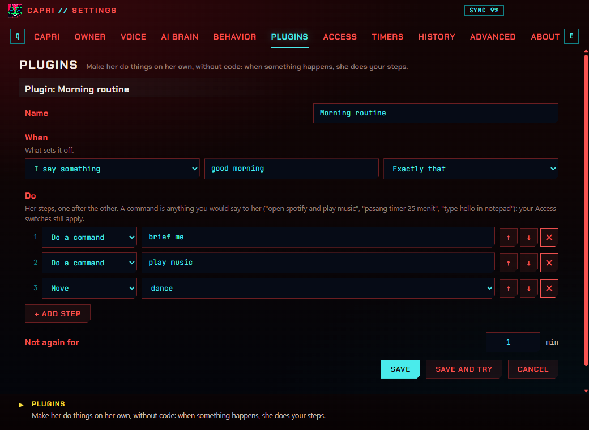
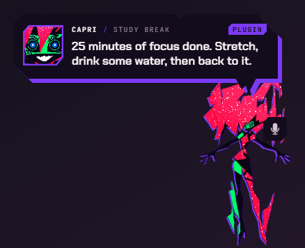

[English](../PLUGINS.md) · **Bahasa Indonesia** · [← README](../../README.id.md)

# Plugin

Plugin adalah otomasi kecil miliknya, dibuat tanpa coding: **SAAT** sesuatu terjadi, dia **MENJALANKAN**
langkah-langkahmu, satu per satu. Buat di Pengaturan › **Plugins**, mulai dari yang siap pakai, dan bagikan sebagai file.



## Saat: yang memicunya

| Saat | Contoh | Cara kerjanya |
| --- | --- | --- |
| **Aku bilang sesuatu** | "mode kerja" | Persis itu, atau "di dalam kalimat" (frasanya di mana saja dalam ucapanmu). Diketik atau diucapkan; namanya dan "tolong" di sekitarnya boleh. |
| **Pada jam tertentu** | 07:30, hari kerja | Sekali di menit itu, di hari yang kamu centang (tidak ada yang dicentang: setiap hari). |
| **Sebuah aplikasi dibuka di depan** | Code, Chrome, Discord | Sebagian nama programnya cukup. |
| **Sebuah lagu mulai** | dari The Weeknd | Lagu apa saja, atau yang judul atau artisnya mengandung kata itu. |
| **Aku kembali setelah pergi** | 30 menit pergi | Pertama kali kamu menyentuh PC setelah pergi selama itu (20 menit atau lebih). |
| **Dia menyala** | | Sebentar setelah dia menyala. |
| **Baterai hampir habis** | di bawah 20% | Sekali, saat turun di bawahnya. |

## Lakukan: langkah-langkahnya

| Langkah | Fungsinya |
| --- | --- |
| **Bilang** | Satu kalimat di panelnya (dan diucapkan, kalau dia membacakan). |
| **Jalankan perintah** | Apa saja yang biasa kamu bilang ke dia: "buka spotify terus putar musik", "pasang timer 25 menit", "ketik halo di notepad", "rangkuman hari ini", "ganti lagu". Lihat [Perintah](PERINTAH.md). |
| **Tunggu** | 1 sampai 600 detik. |
| **Bergerak** | lambai, joget, bungkuk, ke cursor-mu, taskbar, sembunyi, tidur… |
| **Rasakan** | Wajahnya dan sebuah gerakan: happy, jealous, bored, glitch, annoyed. |
| **Notifikasi Windows** | Notifikasi dengan teksmu. |

Maksimal 12 langkah. **Jangan diulang selama** menentukan berapa menit harus lewat sebelum bisa jalan lagi.

Saat kamu memicunya dengan ucapan, langkah-langkah sebelum **Tunggu** pertama langsung menjawabmu (di chat atau panelnya);
sisanya muncul saat terjadi.



## Yang siap pakai

Rutinitas pagi ("good morning": rangkumanmu, musik, joget), Mode kerja, Selamat datang kembali, Suasana ngoding (VS Code
dibuka di depan), Istirahat makan siang (12:00 di hari kerja), Baterai lemah. **Tambah** salah satunya, lalu ubah
sesukamu.

## Berbagi

**Ekspor…** menyimpan plugin sebagai file `.capri-plugin.json`; **Impor…** menambahkan plugin dari file (sampai 20
sekaligus). Isinya JSON biasa:

```json
{
  "capriPlugin": 1,
  "name": "Istirahat belajar",
  "when": { "type": "time", "at": "15:00", "days": [1, 2, 3, 4, 5] },
  "do": [
    { "type": "say", "text": "Peregangan dulu, minum air." },
    { "type": "wait", "seconds": 5 },
    { "type": "command", "text": "pasang timer 5 menit" },
    { "type": "notify", "text": "Waktunya istirahat" }
  ],
  "cooldown": 1
}
```

| `when.type` | Isian |
| --- | --- |
| `said` | `phrase`, `match`: `"exact"` atau `"contains"` |
| `time` | `at`: `"HH:MM"`, `days`: 0 (Minggu) sampai 6, kosong untuk setiap hari |
| `app` | `app`: sebagian nama program |
| `song` | `title`, `artist` (salah satu, keduanya, atau tidak ada) |
| `back` | `minutes`: 20 sampai 600 |
| `start` | |
| `battery` | `below`: 5 sampai 80 (%) |

Langkah: `say` (`text`), `command` (`text`), `wait` (`seconds`), `move` (`move`), `emotion` (`emotion`), `notify` (`text`).

## Aman sejak awal

- **Tidak ada yang tidak akan dia lakukan kalau kamu minta**: perintah di plugin melewati aturannya sendiri dan saklar
  [Access](PENGATURAN.md#access)-mu. Menutup aplikasi tidak pernah dilakukan dari plugin (selalu lewat tombol).
- **Plugin dari file datang dalam keadaan mati**, jadi kamu baca dulu langkah-langkahnya sebelum menyalakannya.
- **Yang tidak bisa dijalankan dibuang** saat plugin disimpan atau diimpor: langkah yang tidak dikenal, jam yang tidak
  valid, terlalu banyak langkah, teks yang terlalu panjang.
- **Tidak ada putaran tanpa akhir**: perintah dari plugin tidak pernah memicu plugin.
- Maksimal 50 plugin.
